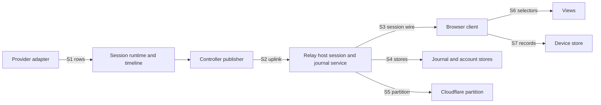

# Seam Contracts

Status: written in migration step M1 of [target architecture and tests](../../superpowers/specs/2026-11-18-target-architecture-and-tests.md); S1 to S3 have fixtures and tests today, S4 to S7 are contracts that later steps make executable.

A seam is a connection between two modules. Each seam has three artefacts that every later change keeps true: this written contract, a fixture set that both sides consume, and a small integration suite in `packages/agent-remote-seams` (or in the owning package when both modules sit in it). Integration tests run the real modules inside the seam and fixtures or in-memory ports outside it. They never start the whole stack, a listener or a process.

## How fixtures are made

| Fixture | Produced by | Home | Rule |
| --- | --- | --- | --- |
| Recording | The native tier against a real CLI (`pnpm test:claude`, `pnpm test:codex-shared` and the provider recorders), with the CLI version in the header | `agent-provider-<name>`, exported through `./recordings` | Never published; a changed recording is a reviewed diff |
| Golden rows | `pnpm transcripts:record` (the rows recorder): the canonical rows and item keys a real agent manager holds for a recording's live run and its reread | beside each recording as `<name>.rows.json` | Reviewed once; a change is a change of S1 behaviour |
| Transcript | `pnpm transcripts:record`: a normalized JSON-lines capture of one scenario, with a header, steps, and frames with direction | `packages/agent-remote-fixtures/transcripts/<uplink or session-wire>` | Ids, times and tokens are placeholders numbered by first appearance; recording twice gives the same file |
| Vector, builder | By hand | the owning package's `./testing` or `agent-remote-fixtures` | Tables and functions |

`pnpm fixtures:check` verifies that every transcript has its header, the protocol version the code declares, the scenario its file is named for, numbered frames and consumers that exist, and that every recording has golden rows and no golden rows are left without a recording. A protocol change fails it until the transcripts are recorded again and the diff is reviewed in the same commit: that one diff is the review of the wire change.

The transcripts and golden rows in the repository were recorded at `baseline/im-session-2026-11-18` and replayed at the commit that introduced them with identical output. A migration step passes only if the seam suites still give them unchanged. A deliberate wire change is a separate commit that records them again.

Recording at an older commit: check it out in a temporary worktree under `.worktrees/`, install with `pnpm install --frozen-lockfile`, copy `packages/agent-remote-fixtures` and `scripts/lib/workspace-source.mjs` into it, add the `./journal-publisher` export to the Controller package, and run `ARC_TRANSCRIPT_OUT=<directory> pnpm exec vitest run --config vitest.record.config.ts` inside the copied package. `ARC_ROWS_OUT` does the same for the golden rows.

## S1 Adapter to Controller rows

- **Parties.** A provider adapter (the SDK port) and the session runtime with the timeline projection; the publisher's `SessionTimelineSource` is the output.
- **Contract.** `AgentProviderAdapter.open` yields `ProviderStreamItem`: `ProviderObservation` (an event and `ProviderItemIdentity { key, completes, liveOnly }`), `ProviderHistoryBoundary` and `ProviderTimelineReplacement`. The runtime projects them to canonical rows with item keys; `loadOlderHistory` returns older rows.
- **Guarantees.** (1) An item has the same key live and when reread after a reopen. (2) History read at open holds every item that is not `liveOnly`. (3) Observations of one session arrive in order; `completes` ends an item. (4) Native interpretation stays in the adapter: the runtime sees only SDK types.
- **Errors.** Adapters raise typed provider errors (unavailable, native owned, unsupported), never a raw native failure. An observation that becomes a row without an identity, or with an empty key or the reserved `controller:` prefix, is an identity breach: the publisher unserves the journal.
- **Fixtures.** `agent-provider-<name>/recordings`: 18 Claude, 12 Codex and 8 Copilot recordings with golden rows; OpenCode and DSH have none yet.
- **Tests today.** `packages/agent-remote-seams/tests/S1` (40): each recording is replayed twice and gives its golden rows; reread keys are keys of the live run; no row lacks an identity or uses a reserved key; every recording has golden rows. The adapter conformance suite inside each provider package is the contract test of the port.
- **Not yet.** Older-history pages continuing the sequence (needs an adapter fixture with older pages); scripted recordings for OpenCode and DSH.

## S2 Controller to Relay uplink

- **Parties.** Controller `uplink-client`, `session-core` and `publisher`; Relay `host-session` and `journal-service`.
- **Contract.** `remote-host-uplink` (version 2): register with capabilities (the Relay requires `control`), heartbeat, rpc with request ids, outbox offers, claims and settlements, native owner reports. `remote-host-journal` (version 1): `journal_open` names the session and publisher; the Relay answers `journal_opened` with the generation and the watermark; `journal_publish` carries numbered entries (`window`, `append`, `complete`, `prepend`, `head`) with the generation; the Relay answers `journal_ack` with the watermark and the cursor (epoch and sequence) or `journal_refused` with a reason; fills and older history are requests with a 15 s deadline; `journal_unserve` stops serving.
- **Guarantees.** Sequences are contiguous per generation and a refused entry consumes none. An acknowledgement means durable. A stale generation is fenced. After any failure the Controller reopens with a new window; there is no other recovery. The Relay never synthesizes runtime state.
- **Errors.** `journal_refused` reasons: `fenced`, `invalid`, `quota_exceeded`, `incomplete`, `sequence_gap`. `journal_request_refused` reasons: `not_followed`, `not_ready`. `journal_open_refused` reason: `unavailable`. Registration refusals for version and revoked Host.
- **Window decision.** The rule that answers a `journal_open` window is one pure function, `decideWindow(tail, window, room?)` in `agent-remote-journal/src/window-decision.ts`; its contract is written in that file. Given what the journal holds and the newest item window the Controller offers, it returns `unchanged`, `extend` (items appended at the end, live-only items added, a held tool call or board rewritten in place) or `replace` with a reason (`new`, `incomplete`, `open_item`, `changed`). Items older than the first shared key are never a change. One vector table, `windowVectors` in the journal's `./testing` entry, is read by three layers: the journal (`decideWindow` and `SessionJournal.sync`), the Controller publisher (the window it builds from timeline items, with its own digests) and the client replica (`absorbWindow`, the window taken by item key with unchanged rows keeping their identity). A change to the rule changes the table and nothing else.
- **Fixtures.** `agent-remote-fixtures/transcripts/uplink`: `publish-recorded-session`, `reopen-unchanged`, `restart-controller`, `reopen-changed-history`, `live-rows-after-open`, `relay-refuses-live-row` (`invalid`), `quota-refuses-window` (`quota_exceeded`, retried with backoff), `connection-drops-and-returns`.
- **Tests today.** `packages/agent-remote-seams/tests/S2` (16): each scenario is run again, with the real publisher over a scripted provider from a Codex recording and the real journal service over in-memory hand-offs and a virtual clock, and must equal its transcript; and the Controller role of each transcript is played against the real journal service, which must answer with the transcript's Relay frames.
- **Not yet.** Registration, heartbeat expiry, rpc, outbox and native owner frames (they need the Controller's uplink client to accept an injected `RelaySocket`; transcripts for them come with that port in the Controller session-core step); one transcript for each of `fenced`, `incomplete`, `sequence_gap`, `not_followed`, `not_ready` and `unavailable`; a player for the Relay role against the Controller side.

## S3 Relay to browser session wire

- **Parties.** Relay `edge` and `journal-service`; client `connection` and `session-client`.
- **Contract.** `session-channel` and `session-control` frames. The page opens with `negotiate`. The Relay answers `negotiated` (with `sessionControl`), then the Snapshot (`agent_snapshot`) and the control state (`session_control`, with a `revision`, `access`, `available`). The page asks for timeline pages (`timeline_request`: `tail`, `before`, `after` with a cursor) and subscribes (`timeline_subscription`); the Relay sends `timeline_page`, live rows as `agent_stream` with dense sequences after the subscription is acknowledged, and `timeline_replacement` with the new epoch when the window is replaced. The page sends `session_control_request` with the revision it saw (`acquire`, `take_over`); the Relay answers with a `session_control` frame carrying the request id, the revision and the lease token. Every mutation carries the token.
- **Guarantees.** Pages are contiguous within an epoch. A replacement is complete in one frame set. The lease is issued only by the Relay. A mutation reaches a Controller only from a stream with a live lease, and the Controller refuses it if a terminal owns the session. The journal serves reads while the Host is offline.
- **Errors.** `protocol_error` with a request id and a code: `session_read_only` (no lease), `session_control_changed` (stale revision), `native_session_owned` (a terminal holds the session; the page then sees a read-only control state with the owner), `host_offline` (recoverable). A refused message leaves the stream open. Close code 4029 for capacity.
- **Fixtures.** `agent-remote-fixtures/transcripts/session-wire`: `open-offline-host`, `live-rows`, `page-after-cursor`, `replacement`, `acquire-control`, `acquire-stale-revision`, `send-without-lease`, `send-acknowledged`, `native-owner-refuses-send`, `send-offline-host`. Each is the browser side only; the Controller is scenery.
- **Tests today.** `packages/agent-remote-seams/tests/S3` (18): each scenario is run again against the real Relay with an in-memory journal store and a scripted Controller and must equal its transcript; and for the seven scenarios whose Relay setup does not depend on the page, the browser role of the transcript is played against that Relay.
- **Lease table.** The control lease of a browser stream is one pure transition table, `transition(state, event)` in `agent-relay-core/src/domain/session-control/session-control.ts` (contract written there), with `viewOf(state)` for the `session_control` frame. A new stream is read-only; `acquire` with the current revision issues the token once and clears the native owner; a stale revision is refused with `session_control_changed`; a mutation passes only with the live token, else `session_read_only`; a delivery refusal `native_session_owned` revokes the token, starts a new revision and records the owner (asked of the Controller when the refusal names none, and counted only for the revision it was asked under). `stream-control.ts` is its shell: it decodes frames, mints ids, asks the Controller and sends what the table replies. The Controller's own owner check at delivery is a separate rule with its own test.
- **Window absorption.** `packages/agent-remote-seams/tests/S3/window-absorb.integration.test.ts` (47) runs the client replica's `absorbWindow` over the window vectors of S2: the window becomes the new timeline by item key, and a held row with equal content keeps its identity.
- **Succession model.** What a page decides about a conversation that moved to another session is pure code in `agent-client/src/succession` (contracts written in each file); the Workbench hook `useSessionSuccession` owns the requests, timers, bindings and documents and applies what the model says. `reduceRefresh(state, event)` returns the next state and effects as data: a discovery that succeeds confirms its evidence; one that cannot reach the Relay (not a timeout, and not after a notification) after an earlier success restores that evidence as stale and retries after 1, 2, 5, 10, then every 30 seconds; a 404 or a missing route with nothing desired and no role means the Relay has no succession; any other failure is reported. `resolveLocator` sends a mentioned session to the one role that confirms it and refuses before discovery, on stale evidence, on unconfirmed or conflicting roles. `sessionSuccessionHistory` accepts only a complete chain of replays (revisions 1, 2, 3 without a gap, from the role's origin to the role the Relay confirmed). `settlementOf`, `committedRefreshOf`, `handoffOutcome` and `restoredSourceOf` decide when a Handoff refresh is complete; `latestReplayByRole`, `continuesRole`, `canPruneSession`, `newerFavoritesHints`, `sourceStaleness` and `roleContextOf` are the remaining decisions. `successionDeadlines` names every wait. The model reads replays as the Relay sends them (`session_succession_committed`, `/session-successions`), so the wire fixtures of the session wire are its input.
- **Not yet.** The client side (the session client against a transcript server, needs the client split), quota trim, reconnect from a cursor across a Relay restart, and the real-WebSocket transport tests that AGENTS.md requires for reconnect and pairing changes.

## S4 Relay to stores

- **Parties.** Relay `journal-service` and `account-state`; the `JournalStore` and `AccountStateStore` implementations.
- **Contract.** `JournalStore`: load, apply (upsert, remove, replace) per key, delete, catalog, with per-Host ordering. `AccountStateStore`: atomic commit and restore of a versioned envelope (the Relay's `commit` and `committedBrokerState` path). A write is durable before it returns. Size limits raise a typed refusal.
- **Fixtures.** Operation vectors in the two `./testing` entries (the store conformance suites).
- **Tests.** None yet; the memory store, `journal-sqlite` and the Durable Object storage run one conformance suite in the store-contracts step.

## S5 Relay to Cloudflare partition

- **Parties.** The Relay's partition proxy and the Cloudflare host's `JournalPartition`.
- **Contract.** `journal-partition.contract.json`: capabilities, open, publish, page and fill calls, replies halved to stay under 24 MiB, per-Host ordering, a capability retry every 30 s.
- **Fixtures.** The contract JSON, regenerated from the in-process partition; size vectors for the halving.
- **Tests.** None yet; the proxy against a contract player and the partition server against the same contract in Node come with the Cloudflare step.

## S6 Client replica to renderer

- **Parties.** The client `replica` and the views of `agent-client-web` and the Workbench.
- **Contract.** The renderer reads selectors only: the timeline of a session as rows keyed by item key with `hasOlder` and `epochPending`, and a session view with status, lease view and the send-state words. It issues commands: send, load older, acquire, retry. Views never read frames or raw state. Selectors return the same object when content is equal.
- **Guarantees.** Keys are stable across a replacement; unchanged rows keep their identity; the reader's anchor survives a replacement.
- **Send state.** What a reader sees of a message they sent is one pure table, `transition(state, event)` and `describe(state, delivery)` in `agent-client/src/replica/send-state.ts` (contract written there). States: `sending`, `awaiting_echo`, `unconfirmed`, `failed`; a message leaves the pending list (`delivered`) by its echo or when the Host handled it as a command. An acknowledgement never lifts `unconfirmed` and never touches `failed`; an echo never settles `failed`; only `failed` and `unconfirmed` may be retried or deleted; a retry repeats the same operation only when the first attempt is uncertain, still has its place in the conversation and the Host can run it again. The pending list itself, matching echoes to messages, is `replica/pending-messages.ts`.
- **Restored state.** A state restored from the device (`timeline.restoredFromDevice`) is a display: the timeline draws its rows by item key at once, and the composer takes a draft and offers no send until the first server page confirms the state.
- **Fixtures.** `buildReplica`, `buildRestoredReplica`, `buildTailPage` and `replicaAfter(frames)` in `agent-client/testing`, with the builders `buildEntry`, `buildSnapshot` and `buildStoredRecord`.
- **Tests.** `agent-remote-seams/tests/S6` (8): the real replica and the real timeline and composer with no connection; unchanged rows keep their nodes across a confirmation, a replacement and a live row; the send-state words; a restored composer. The unit tests of the views and of the replica reducers stay with their modules.

## S7 Device store to replica

- **Parties.** The client `device-store` and `replica`; `DeviceDatabase` as the port.
- **Contract.** Save and restore of a stored record: key, Relay URL, version, epoch, next sequence, whether older history exists, entries, Snapshot, update time, byte size. Writes follow a settled batch, bounded by a byte budget with least-recently-used eviction. A restored record seeds the replica marked restored and is never authoritative; the first server page replaces it by item key. A version mismatch discards the record.
- **Display lease.** Rows of a record show only while the person's lease is valid (`displayLeaseValid`): confirmed by the Relay, or not yet past the end the Relay last reported; never after a refusal (which purges the records), while an expired lease is confirmed again, or after the workspace was retired.
- **Ports.** `DeviceDatabase` (`readIndex`, `read`, `write` of one batch, `clear`) is the store's only storage; `PageLifecycle` tells it when the page is hidden. `agent-client-web` installs the IndexedDB database and the browser page when imported.
- **Fixtures.** `buildStoredRecord`; `agent-remote-seams/tests/S7/fixtures/device-record.v1.json`, frozen for stored version 1 (a new version adds a file, never edits one).
- **Tests.** `agent-remote-seams/tests/S7` (12): a restored record paints before any frame arrives; a restore carries no turn or interaction; the first server page confirms by item key, replaces, or starts a new epoch; a read replica ignores the device; version, person and session mismatches are discarded; purge; byte-budget eviction; the window limit; the frozen v1 record. The `DeviceDatabase` contract runs on the memory database (`agent-client`) and on IndexedDB (`agent-client-web`).

## Changing a seam

1. Change this document first when a guarantee or an error changes.
2. Record the affected scenarios again with `pnpm transcripts:record`; review the diff of the transcripts and golden rows, which is the review of the change.
3. Run `pnpm fixtures:check` and the seam suites (`pnpm test:unit agent-remote-seams`) and the contract suites of every consumer of the fixture.
4. A rule that a seam test cannot name has no owner module yet: extract the module before adding the test.
