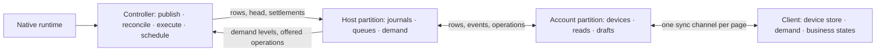

# IM-grade session service: Relay journals, one operation queue, schedulable agent sessions

Status: draft for the owner's review, 2026-11-15. It builds on [IM gateway: product form](2026-11-13-im-gateway-product-form.md) and [Bot and Window: product model](2026-11-13-bot-window-product-model.md), and moves IM gateway decision 1 from C (previews only) to B (stored session timelines), with the storage designed here.

## Why

The owner works mostly in Edge and waits often. Switching a Window or a bot shows Opening session, Reconnecting, Synchronizing, Restoring or Checking access, and the page feels slow. The causes are in the design, not in the browser:

1. **Reading is bound to the control path.** Every view attaches through the Relay to the Controller (`packages/agent-remote-hosted/src/broker.ts:1151-1251`), and snapshot and timeline reads go to the Host as well (`broker.ts:2016-2025`). When the runtime was released, the Controller reopens the native session before anything is shown (`packages/agent-host/src/host.ts:899-985`). The hosted Relay stores no content by design (`docs/blueprint/agent-remote-observation.md:156-167`).
2. **The Controller's timeline lives in memory, one epoch per open.** Each open mints a random epoch (`packages/agent-remote-relay/src/relay.ts:133,220,281`). Codex and OpenCode runtimes are released after five idle minutes (`packages/agent-host/src/idle-sessions.ts:16`). The next open makes every client cursor stale (`packages/agent-remote-relay/src/timeline-projector.ts:70-76`), so clients empty the conversation and reload its latest 100 entries.
3. **Browsers ration Controller streams.** An account may hold 64 streams and a Host serves 128 (`packages/agent-remote-hosted/src/broker.ts:2427-2428`). The live budget keeps the four most recent conversations plus 20 seconds (`packages/agent-remote-lab/src/live-budget.ts:7-8`). Returning to a released conversation repeats attach, negotiation, the control check and catch-up.
4. **Hidden pages stop recovering.** A hidden page does not restore sessions (`packages/agent-remote-lab/src/session-restoration.ts`). Every reconnect returns each session to `checking` until `session_control` arrives (`packages/agent-remote-web/src/client/remote-session-client.ts:214`).
5. **Browser copies are thin.** At most six replicas stay in memory (`packages/agent-remote-lab/src/replica-cache.ts:6`). The local-storage preview keeps 150 entries for six sessions and no cursor (`packages/agent-remote-lab/src/workspace-cache.ts:7-8,63`). Pending sends live in memory and drain only in the foreground (`packages/agent-remote-web/src/react/usePendingSend.ts`).
6. **Four delivery mechanisms exist side by side:** the Relay outbox, the Team queue, TPM intents on the Controller and a process-local operation cache.
7. **All accounts share one Durable Object.** Its whole state is held in memory and bounded at 16 MiB (`packages/agent-remote-cloudflare/src/worker.ts:35`, `packages/agent-remote-hosted/src/gateway.ts:84`).

Long conversations add their own lag. Nothing virtualizes the timeline, each delta does work proportional to the conversation, and the streaming reply's Markdown is parsed again on every delta (`packages/agent-remote-lab/performance/README.md`). That is a separate project (see Scope).

## Goal

An IM experience in which no user action waits on the network. Content appears at once and sending never blocks. How fast the agent side answers is information, not a gate.

### Experience targets

These are proposals. Phase P0 measures today's values and confirms each number before implementation starts.

| # | Target |
|---|---|
| T1 | A conversation opened before on this device shows its content from the device store within 100 ms (p95) of mounting, with no blank or loading state. |
| T2 | A conversation with a journal that this device has never opened shows journal content within 500 ms (p50) and 1.5 s (p95), without reaching the Controller. A journal exists once the session was opened on any device, or was active, after smart mode began. |
| T3 | Returning to a page after any time hidden shows no blocking state. Content is current within 1 s (p95) when the device can reach the Relay. |
| T4 | Connection and runtime state never disable the composer; only business reasons do (read-only access, an ended session, a terminal in control). A message shows as sending within 50 ms. A resident session accepts it within 1 s (p95); a released one within the provider's measured wake time plus 1 s. |
| T5 | In smart mode no per-session connection label appears (Opening session, Reconnecting, Synchronizing, Restoring, Checking access). One indicator shows the device's own link to the Relay. |
| T6 | A Controller restart or a runtime release never resets a client's conversation, unless the native history was genuinely rewritten. |

## Principles

Confirmed by the owner on 2026-11-15.

1. **Clients express needs; the service fulfils them.** A client subscribes to what it shows, submits operations and reports demand. Talking to a session is a stable contract. What answers behind it may change at any time.
2. **The agent side is information, not a dependency.** A slow or absent Controller or native runtime appears as business state. When the business needs the agent, for example its answer or its acceptance of input, the business logic waits asynchronously. The interface never waits.
3. **Scheduling is invisible to clients.** The Relay and the Controller decide which runtimes stay resident. Clients see business states only: what the agent is doing and what happened to their operations.
4. **Clients are the source of demand.** Only a client knows what the person is doing: typing, looking, about to open. Clients report it and the scheduler decides.
5. **The Relay is the hub and may store content.** It keeps each session's journal and the operation queue, and it aggregates demand.
6. **One client contract, two server modes.** The same client protocol works against today's forwarding ("crude" mode) and the new service ("smart" mode). The mode is chosen per Host and per provider on that Host, and smart mode can be switched off the same way. Crude mode is a transition and rollback path; it is removed once every Controller has been updated.
7. **Automation is a client.** Gateway automation, the command line, Teams, TPM and agents operate sessions through the same operation queue and events.
8. **The conversation is the agent session** (the IM gateway principle). A journal is a copy that can be rebuilt from native history. The Relay never authors a second conversation.
9. **Today's topology is not a constraint.** The Relay may be partitioned differently and may use new middleware wherever the design needs it.

## Requirements behind the current code

These invariants are kept. Each one names the code that protects it today.

### Timeline and protocol

- **Dense, monotone sequences.** Sequence numbers are dense and monotone within an epoch. A live row has the same sequence and granularity as the row later served in pages (`packages/agent-remote-web/src/replica/reducer.ts:263-298`).
- **Epoch changes.** The epoch changes only on a genuine replacement, announced with `timeline_replacement`. A stale cursor returns `reset` and `staleCursor`; a cursor ahead of history returns `gap` (`packages/agent-remote-relay/src/timeline-projector.ts:70-85`).
- **Order on a connection.** A subscription is acknowledged before its first live event, and the Snapshot precedes updates (`packages/agent-remote-relay/src/session-wire.ts:141-149,213-227`).
- **Amendments and prepends.** Rows can be amended in place (resource bindings, background outcomes). Older history is prepended with negative sequences (`packages/agent-remote-relay/src/timeline-store.ts:63-92`).
- **Versioning.** The protocol version must match exactly; it is `1.8.0` today (`packages/agent-remote-protocol/src/version.ts:3`). Features arrive as opt-in channel flags, as successions, titles, states, reads, drafts and outbox did (`packages/agent-remote-hosted/src/gateway.ts:1012-1037`).

### Operations

- **Idempotency.** An `operationId` is idempotent over scope, kind, target and parameters. A changed intent with the same id is `operation_conflict` (`packages/agent-remote-relay/src/operation-cache.ts`).
- **No automatic replay.** An uncertain outcome is never replayed automatically. It stays unknown until a person, or an explicitly new attempt, resolves it. A receipt is written before the native send (`packages/agent-host/src/session-outbox.ts:97-132`, `docs/tpm-delivery.md`).
- **Acceptance is not completion.** Accepted is neither consumed nor completed, and the native disposition `started | queued | handled` is kept (`packages/agent-remote-protocol/src/messages.ts:149-164`; blueprint, Composer message delivery).
- **One answer per interaction.** An interaction response is valid only while its request is pending, and only one response can claim it (blueprint, Typed Interactions).
- **Safe delivery moment.** A message starts a new turn when the session is idle. It goes to the next turn only where the provider has a native follow-up queue. Remote never manufactures a queue (`packages/agent-host/src/session-outbox.ts:122`; blueprint, Composer message delivery).
- **Successions.** Delivery follows successions to the current session (`packages/agent-host/src/session-outbox.ts:111`).
- **Requesters.** The requester is recorded. A session cannot answer its own request or loosen its own permissions, and permission changes need a recent sign-in (`packages/agent-host/src/session-routes.ts:238,254`; `packages/agent-remote-hosted/src/broker.ts:1946-1948,2085`).

### Access

- **Authorization before dispatch.** `sessionAllowed` admits the owner, or the creator when the reader is a share recipient; `hostAllowed` and `requireOwner` guard the rest (`packages/agent-remote-hosted/src/broker.ts:666-669`). Revoking a share closes live streams at once (`broker.ts:2318`). A share recipient's sessions are hidden from commands and hold no session credential (`packages/agent-host/src/session-callers.ts:87-97`).
- **Native CLI control.** A session controlled by a native CLI is read-only for operators until an explicit take-over (`packages/agent-remote-relay/src/session-control.ts:34-50`).

### IM product

- **Per-account state:** drafts (the last editor wins and local typing is never overwritten), reads (they only advance), fold and sleep, and queued messages that every device can see and cancel until they are claimed. **Per-device state:** layout and tab-local ledgers (`docs/guides/bot-window-workbench.md`).
- **Attention.** Unread is a dot, never a count, and needs-you is distinct from unread. Background and quiet reviews do not notify. An unknown or offline state keeps the last known one (`packages/agent-remote-lab/src/bot-attention.ts`).
- **Queued messages.** A queued message is shown as not yet part of the conversation and shows its age after a minute (`packages/agent-remote-lab/src/components/OutboxMessages.tsx`).

### Boundaries and process

- **Boundaries.** The Provider SDK, wire protocol, Relay state, native adapters and renderer stay separate, and native interpretation stays in adapters (`AGENTS.md`).
- **Process.**
  - Protocol fixtures, replay behaviour, schemas and compatibility metadata change together.
  - Changes to protocol, pairing or reconnect are tested over real transports.
  - Changes to the website, Relay or Controller are verified on `pnpm local` (`AGENTS.md`).

## Scope

This design covers the Relay journal and the operation queue, with the client changes they need, and schedulable agent sessions. It does not cover:

- **Long-conversation rendering.** That project is independent and can run in parallel.
- **The desktop app.** It comes after this work and builds on it.
- **Gateway automation features.** This design only provides the queue and events they will use.
- **Search.**

The standalone loopback workbench keeps today's forwarding.

## Architecture

### Roles

| Role | Owns | Does not own |
|---|---|---|
| Client (browser, command line, automation) | A device store of conversations with cursors and its own pending operations; one sync channel; demand reports; presentation of business states | Scheduling, delivery, authority |
| Relay control plane | Accounts, sign-in, device keys, the Host registry, bindings, shares, Teams, Windows and groups, titles, stars, relations | Conversation content |
| Relay Host partition (one per Host) | The journals of that Host's sessions, their operation queues, presence, per-session demand, and the Controller's uplink | Account-wide IM records |
| Relay account partition (one per account) | Its devices' sync channels; reads, drafts, fold and sleep; the account's view of its operations; fan-in from the Host partitions it reads | Journals |
| Blob store | Large row bodies, resources, attachments | Ordering |
| Controller | Publishing journals, reconciling after a reopen, executing operations (claim, receipt, wake, deliver, settle), residency decisions | Presentation |
| Provider adapter | Stable item identity, marking live-only items, detecting rewrites | Relay or scheduling decisions |

The Host is the journal's home for three reasons:

- It is the single producer of its sessions' content.
- It is the unit of sharing: grants are per Host and subject (`packages/agent-remote-hosted/src/host-sharing.ts`).
- It is the unit of scheduling: one machine's runtimes.

One writer per partition makes ordering and sequence assignment simple. Accounts are where devices and IM records belong, so device channels end there and fan in from the Hosts they read. Two other homes were rejected:

- A partition per session would multiply routing and would still need a per-Host view for scheduling.
- A partition per account would split a shared session's journal across accounts.

### Data flows

- **Read.** The client renders its device store at once, then subscribes on its sync channel with each session's cursor. The account partition authorizes the subscription and subscribes to the Host partition. The Host partition answers from the journal: a page after the cursor, then live rows. No Controller is involved.
- **Produce.** The native runtime emits observations and the Controller publishes rows to the Host partition. The Host partition assigns journal sequences and stores rows in batches. It sends a row on only once it is durable: to the subscribed account partitions, and through them to devices. Devices persist what they receive.
- **Operate.**
  1. The client stores the operation locally, shown as sending, and submits it.
  2. The Host partition authorizes and queues it, then offers it to the Controller.
  3. The Controller claims it, writes a receipt, wakes the runtime if needed, delivers it and settles it.
  4. The outcome reaches every device of the requester. The message joins the conversation when its echo arrives in the journal.
- **Reconnect.** A device reconnects one channel and resubscribes with its cursors. A Controller reconnects its uplink and resumes publishing from the last position the Host partition acknowledged.
- **Schedule.** Clients report demand. The Host partition combines it per session with server-known facts: running turns, pending interactions, queued operations. It sends demand levels to the Controller, which decides residency within its limits.

### Deployment and middleware

The core is written as partition actors behind ports: journal store, queue store, blob store, and messaging between partitions. The same logic then runs in every deployment.

| Need | Cloudflare (production and the self-hosted template) | Node (self-hosted Docker and `pnpm local`) |
|---|---|---|
| Partition actors with storage and sockets | One Durable Object class per role (control plane, Host, account), each with SQLite | In-process actors with embedded SQLite files under the data volume |
| Large bodies, resources, attachments | R2 | Files under the data volume, or S3-compatible storage when configured |
| Messages between partitions | Durable Object RPC | In-process calls |
| Operation queues | Inside the Host partition, ordered per session, with claim and settle | Same |

Considered and not chosen now: an external log or broker, such as Postgres with NATS JetStream or Redis Streams, plus S3.

- Durable Objects already give partitioned single-writer actors with transactional SQLite and WebSockets, and embedded SQLite covers Node.
- An external broker would add operations work for every self-hoster without adding a guarantee this design needs.
- The ports keep it possible for a later clustered deployment.

The journal and queue logic live in a package that defines the ports and binds no storage. The Node SQLite adapter lives in its own package that only the Node Relay host depends on. The Controller depends on `agent-remote-hosted` and `agent-remote-relay`, so neither may pull in a native module. The P1 plan chooses the binding (`node:sqlite`, or a native module in the Relay image) with a benchmark.

Durable Object limits apply per object: memory per isolate, storage per object, size per stored value. Journals stay within them through per-session budgets, a per-Host quota, rows chunked at the existing 256 KiB convention (`packages/agent-remote-cloudflare/src/storage.ts`) and blob offload. A Host whose content outgrows one object is later split by session.

Partitioning removes today's bounds: one object for all accounts, a whole state in memory, commits serialized across accounts. Journals and queues never enter the control-plane state, so the 16 MiB bound and its full-state validation (`packages/agent-remote-hosted/src/gateway.ts:84`) no longer limit conversation content.

### Moving the Relay to partitions

Each step is additive and reversible. A Host without smart mode keeps today's path throughout.

1. **Journals and queues move out.** Add the Host partition for journals and queues. Today's `primary` object keeps every socket and reaches the partition by RPC:
   - Controller rows go to the partition, which stamps and stores them and returns them;
   - `primary` then fans them out;
   - page reads go to the partition.

   Rows travel in batches, so the extra hop inside the data centre is paid per batch, not per delta.
2. **Sockets move out.** Move each Controller's uplink to its Host partition and each device's sync channel to its account partition. `primary` becomes the control plane.
3. **Documents move out.** Split the remaining account-scoped documents out of the control plane when their size or traffic requires it.

## Session journal

### Contents

A journal belongs to one public session, that is, one binding of Host, provider and native session. It holds:

- **Rows.** Rows live under a journal epoch, with dense sequences assigned by the Host partition. A row is today's timeline row (source key, native revision, normalized event, occurrence time) plus an **item key** (below). A row's body may be evicted; its place in the sequence and its item stay (see Retention).
- **Head.**
  - The latest Snapshot the Controller published, with the time it was observed.
  - Presence, computed by the Relay: whether the Host is online, whether a runtime is resident, and who owns the native session.
- **Amendments.** Resource-binding replacements and background outcomes are applied in place and replayed to subscribers, as today.
- **Item index.** It covers every item the journal has seen, including items whose bodies were evicted. For each item it records:
  - its key and sequence range;
  - whether it is `open` or `complete`, and its content digest;
  - whether it is live-only;
  - the `clientMessageId` alias of an echo;
  - its revision in the journal.

  The index is the journal's skeleton.
- **Retired epochs.** They are kept for seven days after a replacement, for diagnostics only. Clients never read them; a cursor on a retired epoch is reset.

Pages come from the existing projector and store. `packages/agent-remote-relay/src/timeline-projector.ts` and `timeline-store.ts` use no Node APIs and can run in a Worker, so live rows and pages keep the same granularity.

### Item identity

Row source keys do not survive a reopen:

- Claude streams live text under `stream:` keys but reads history under record keys (`packages/agent-provider-claude/src/projector.ts:154,163`).
- Codex deltas carry random keys (`packages/agent-provider-codex/src/projector.ts:213`).

Finalized items are stable, however: record and message ids, call ids, native item ids, part ids.

- **Item keys.** Each adapter adds an item key to every observation. It is the native identity of the finalized item the row belongs to, and it is the same whether the item was observed live or read from history.
  - Adapters own the derivation and prove it with fixtures: record a session live, read it again, and compare the keys.
- **Completion and digests.** An item is `open` in the index until its completion row arrives, then `complete`. Providers already emit completion rows: Codex `item/completed`, the final Claude record, Copilot `assistant.message`.
  - The adapter computes the item's digest over its canonical normalized content, with the same function live and on reread.
  - The completion row carries the digest, and the Host partition stores it in the index.
  - An item interrupted mid-stream stays `open`.
- **Corrections.** The Controller publishes a **correction** row with the full content when a reread finds an `open` item, or a `complete` item whose digest differs. The projector uses it as the item's content and counts the earlier rows as contributors.
- **Echoes.** A user message's item key is its native identity, never the `operationId`.
  - The Controller attaches the `operationId` as `clientMessageId` when it publishes the echo.
  - When the native id is not known at send time, the Controller records the alias the first time it observes the echo, and the index keeps it.
  - A reread therefore matches the echo by its native key and adds nothing.
- **Items without a native identity**, such as Controller-made errors, get a key that the Controller assigns and the journal keeps.
- **Live-only items.** Adapters mark the provider's live-only items (interaction records); the Controller marks its own (Controller errors). A reread cannot reproduce them, so the journal holds their only copy.

### Continuing a journal across reopens

After every open, the Controller reconciles the history it read with the journal. An open is a first attach, a restart, a wake after release, or a provider refresh.

1. **Fence.** Each uplink connection is a new publisher generation. The Host partition accepts rows only from the current generation, so a stale connection cannot write.
2. **Read the index.** The Controller asks the Host partition for the session's item index, with each item's revision.
3. **Keep history before live.** The adapter already delivers the reread before its single history boundary and holds live output until after it (blueprint, Provider Contract).
   - The Controller publishes live rows only after its reconcile is committed.
   - A correction names the item revision it was computed against. The Host partition rejects it if the item has moved, and the Controller reads that item again.
4. **Compare only inside the reread's window.** A reread covers all history for Claude and Copilot, but only the latest page for Codex and OpenCode. Its oldest item is the anchor. Journal items older than the anchor are outside the window and stay as they are.
5. **Walk the window.**
   - An unknown item is appended.
   - An `open` item, or a `complete` item whose digest differs, gets a correction.
   - An identical item is skipped.
   - Live-only items are left out of the comparison.
6. **Replace only on a genuine rewrite.** An item known inside the window but missing from the reread, or a change of order inside the window, means the native history was rewritten. Examples are an OpenCode reorder or revert, a Codex recovery, or history that shrank. The Controller then publishes a **replacement**, and the Host partition starts a new journal epoch from the reread and announces `timeline_replacement`. In every other case the epoch continues.
7. **Close a gap.** If the anchor is not in the journal, more than one page of activity went unobserved. The Controller reads further back through native history until it reaches a known item, within a bound. Past the bound it publishes a replacement.

A provider `timeline_replacement` whose reread only adds items continues the epoch instead of replacing it. Prompt edit and fork already create a new native session in every provider, and therefore a new journal. They are not rewrites.

This is what makes T6 hold.

### Knowing when a journal is behind

A Controller observes only resident sessions. Activity it did not see happens in two ways:

- a native client uses a Codex daemon or OpenCode server that this Controller is not subscribed to;
- a native CLI controls the session.

Catalog confirmations reveal it. They arrive about once a minute (`packages/agent-host/src/session-state-publisher.ts:45-52`). When a confirmation is newer than the journal's last item:

- the Host partition marks the journal **behind**;
- when the session has demand, the Host partition asks the Controller to reconcile.

**Terminal-driven sessions stay current.** The owner decided this on 2026-11-15.

- The Controller observes a session that a native CLI controls without taking control. Where the provider writes a transcript, the Controller tails it (Claude JSONL, Codex rollout files). Where the native side is a shared server (Codex daemon, OpenCode server), the Controller stays subscribed as a read-only observer. It publishes what it sees into the journal.
- Observation never writes to the native session and never contends for its ownership.
- Until a provider supports such observation, catalog confirmations mark its journals behind and trigger a reconcile, as above.

**Backfill.** While a Controller is idle, it creates journals for its most recently active catalog sessions, within a bounded budget, so most first opens find a journal.

- Backfill must not start runtimes. It uses a read-only history capability that adapters offer where the native side allows it, such as reading a transcript file or a server's message list.
- Today's SDK reads older history only through an open session (`packages/agent-provider-sdk/src/provider.ts:225`), so this is new adapter work.
- Providers without the capability are not backfilled; their journals begin at the first open.

### Older history

A journal begins with the history the Controller read the first time it published that session. For Claude and Copilot that is all of the history; for Codex and OpenCode it is the latest page.

A `before` page that reaches evicted bodies is filled from the Host (see Retention). A `before` page that reaches beyond anything the journal has seen is answered with `hasOlder: true`. When the Host is online, the Host partition also asks the Controller to read further. The Controller publishes the result as prepended rows with negative sequences, as `TimelineStore.prepend` does today. The client shows the older region as loading inline, and nothing else waits.

- One older-history read is in flight per journal at a time.
- The Host partition stamps its rows as one atomic batch below the current oldest sequence, and the item index makes a repeated read add nothing.
- Sequences stay dense in both directions: forward rows grow upward, prepended rows grow downward.

### Durability and fan-out

A row reaches clients only after it is durable in the journal. A Controller's publication is acknowledged at the same moment.

- **Batching.** The Host partition stamps and stores rows in batches. Before publishing, the Controller merges consecutive deltas of the same item over a short window, which bounds the write rate.
- **Cloudflare.** A Durable Object's output gate holds its outgoing messages and RPC replies until its writes are durable. An object that receives rows forwards only what it received.
- **Node.** Node stores the row before sending it.

### Retention: a working set filled from the ground truth

The native session on the Host is the ground truth, so a journal is a working set, not an archive. It keeps what reading and continuity need, and the scheduler fills in the rest from the Host when someone needs it. Retention is decided by use, not by a size quota; the owner decided this on 2026-11-15.

- **Always kept.**
  - The skeleton: the item index for all history the journal has seen. It is small, and it keeps sequences stable when bodies come and go.
  - The head and presence.
  - Live-only items. Nothing can rebuild them, so they are kept for the life of the session, up to a per-session count cap. Beyond the cap the oldest are dropped, and a diagnostic records the loss.
  - Operation records and echo aliases, for their retention period.
- **Resident bodies.** The latest turns of each session, sized by demand.
  - A session in use keeps a larger window (proposed: the latest 50 turns).
  - A session nobody has used for a while shrinks to what previews and a first screen need (proposed: the latest 5 turns).
  - P0 measures how far back people actually read before these numbers are set.
- **Filled on demand.** A reader can reach a turn whose body is not resident.
  1. The Host partition asks the Controller for the missing bodies.
  2. The Controller reads them from native history, preferring the read-only history capability over opening a runtime.
  3. The filled rows return to the same sequences, and their digests are checked against the index. A mismatch is a rewrite and is handled as one.
  4. Filled bodies stay while they are being read, then are evicted again.

  One fill is in flight per journal at a time. A fill is scheduled like a wake, so a person scrolling back is served before backfill.
- **Large outputs.** A tool output above an inline threshold keeps only a preview in the journal.
  - Its full body is filled from the Host when the person expands it.
  - A client without the flag receives pages whose large bodies were filled before the answer, so it never meets a truncated item.
- **While the Host is offline.** Resident content and the device store stay readable. Older content shows as available when the computer is back. This is a fact the reader sees, not a wait.
- **Safety bounds.** A byte cap per session and quotas per Host and account stop runaway growth. They are not the retention policy.
- **Deletion.** Removing a session's binding, or an account, deletes its journal and blobs.

### Access

- **Rules.** Reads and submissions are authorized in the Host partition with today's rules: `sessionAllowed`, `hostAllowed` and `requireOwner` (`packages/agent-remote-hosted/src/broker.ts:666-669`).
- **Mirroring.** The control plane mirrors the bindings, creators and shares of a Host's sessions into that Host's partition.
- **Revocation.** A revocation is applied in the Host partition before the control plane acknowledges it.

### Answering the client protocol in smart mode

| Contract | In smart mode |
|---|---|
| `negotiate` and `negotiated` | The Relay answers. Clients opt in with channel query flags, and the channel's `ready` frame confirms them, as it does today (`packages/agent-remote-protocol/src/session-channel.ts:49`). |
| Snapshot | Sent from the journal head. With the flag it carries the observation time and whether it is live. Without the flag, `runtimeInfo.connection` reads `restoring` while no runtime is resident. Such clients then keep deferring sends as they do today, and their subscription counts as demand, so the runtime is woken. |
| Timeline pages and live rows | Served from the journal, with journal epochs and sequences. Pages carry projected entries in today's format, and a correction is folded into its item's entry, so no client meets a new row type. A client without the flag does not receive corrections live. The skipped sequence reads as a gap, and its `after` page brings the corrected entry, which is today's recovery path. The first time a session becomes journal-served, a client still holding the Controller's epoch is reset once. |
| `session_control` | The Relay issues tokens at once from the last known native owner. Native-owner changes still originate at the Controller and revoke tokens. |
| Operations | Queued at once (see Operation queue). `command_acknowledged` is still sent when the native runtime accepts. |
| `list_commands`, `execute_command`, and resource reads not in the blob store | Forwarded to the live runtime. A released runtime is woken, and the wait shows inside the menu or the attachment, not on the conversation. |
| Titles, migrations, successions, states, reads, drafts | Unchanged Relay records. |

## Operation queue

One queue serves every requester. It replaces four mechanisms: the Relay outbox, the Team queue, TPM intents and the process-local operation cache.

### Operation record

| Field | Meaning |
|---|---|
| `operationId` | Supplied by the requester; the idempotency key. |
| Requester | Kind (`user`, `session`, `automation`, `external`) and identity, plus the account it acts for. |
| Target | The public session. It is resolved through successions at delivery time. |
| Kind and payload | `send_message`, `steer`, `cancel`, `interaction_response`, `set_session_setting`, `set_planning`, `team_message` or `tpm_intent`. Text is bounded; attachments travel as blob references. |
| Delivery | `immediate`: start when idle, steer when active. `next_turn`: only where the provider has a native follow-up queue. `later`: today's outbox rule. A new turn when idle. While a turn runs, the next turn where the provider has a native follow-up queue; otherwise the message waits, shown as waiting for the current turn. It never steers. |
| Preconditions | Facts checked at delivery. For example: the interaction request is still pending, the turn named by a cancel is still active, the setting choice is still offered, the TPM work is approved and not archived. |
| Deadline | Optional. The queue wait counts from submission. The native wait counts from dispatch, so a setting's 30-second confirmation no longer includes time spent queued. |
| State | `queued`, `dispatching`, `accepted` (with the native disposition), `rejected` (with a reason), `unknown`, `cancelled` or `expired`. |

### Life of an operation

1. **Submit.** The Host partition authorizes the operation with the same checks as reads, validates it and stores it as `queued`. Repeating an `operationId` with the same content returns the existing record; repeating it with different content is `operation_conflict`.
2. **Offer.** The Host partition notifies the Controller. A Controller that reconnects asks for its queue.
3. **Claim.** The Controller claims the operation (`queued` becomes `dispatching`) and writes a local `claimed` receipt.
4. **Wake.** A released runtime is reopened within the provider's wake deadline. No native call has been made yet, so a failed wake may be tried again within the operation's deadline. When the deadline passes, the operation settles `rejected`: it was definitely not delivered.
5. **Deliver.** The preconditions are checked against the live runtime; a failing one settles `rejected` with its reason. Otherwise the Controller makes its receipt durable as `sending`, and only then makes the native call according to the delivery rule.
6. **Settle.** The outcome is `accepted` with the native disposition, `rejected`, or `unknown`. After a Controller restart:
   - a `sending` receipt settles `unknown`, and the operation is never sent again;
   - a `claimed` receipt, or no receipt, returns the operation to `queued`, because the native call is made only after a durable `sending` receipt.
7. **Echo.** On the `user_message` row it publishes for that input, the Controller sets `clientMessageId` to the `operationId` and records the requester as the sender. Clients then match the echo exactly instead of comparing text. Both fields travel behind the opt-in flag; clients without it receive the row without them.

**Cancel and retry.**

- The requester can cancel an operation while it is `queued`.
- Retrying after `rejected` or `unknown` creates a new operation with a new id. Only a person, or automation that decides so explicitly, does that.

**Receipts are the authority** on whether a native call may have happened.

- After a Relay restore or a partition move, the Host partition asks the Controller for its receipts and corrects queue states from them.
- Queue records and receipts are kept for 30 days after settlement. A late resubmission of the same id is answered from them instead of running again.

**Successions.** If the target was succeeded before delivery, the operation records the successor it was delivered to, and the echo lands in the successor's journal.

- Bot mode shows the chain as one conversation.
- Window mode shows the operation in the original session, with a link to the successor.

**Not queued.** Creating a session, Ask, Side, fork, prompt edit and Handoff stay request and response. They keep today's reserved identities and today's rule that an uncertain creation is never repeated.

### Delivery choice

The composer submits `immediate` while the Host is online, so a message behaves exactly like today's send. While the Host is offline, the composer submits `later`, which is today's outbox rule (`packages/agent-host/src/session-outbox.ts:122`): the message never steers into a turn that started later. Either way the person sees one action, and the Host being offline is shown as a fact.

A share recipient's operation is accepted only while the Host is online, and it is never held for offline delivery. That is today's outbox rule (`packages/agent-remote-hosted/src/session-outbox.ts:44`).

### Which operations wake a runtime

| Operation | Behaviour |
|---|---|
| `send_message`, `set_session_setting`, `set_planning`, `team_message`, `tpm_intent` | May wake a released runtime. |
| `interaction_response`, `steer`, `cancel` | Never need to wake one. A session with a pending interaction or a running turn always stays resident. If its runtime is gone anyway, the precondition fails and the operation is rejected as stale. Stopping a turn in a session that a terminal controls is a take-over, which already interrupts running work (`packages/agent-host/src/native-owner-admission.ts`). |
| `list_commands`, `execute_command` | Stay request and response with the live runtime; they are not queued. |

### Events

Every session emits business events derived from its journal and head:

- turn started, turn finished;
- waiting for input, interaction resolved;
- operation settled;
- Host online or offline;
- native CLI in control.

Each event carries a cursor, so tabs and devices can drop duplicates. Clients receive events on the sync channel; automation will read them through an event API. Server-side attention, and notifications with no open page (IM gateway decision 3), use the same events.

### Requesters

- **`user`.** A person acting through a browser or the command line.
- **`session`.** An agent session acting through its session token or tools, including one agent writing to another through the gateway.
  - It submits through its own Controller, which authenticates the token and stamps the session's identity. The Relay trusts a Host only for its own sessions.
  - The target's Host partition refuses a session that answers its own request or loosens its own permissions. It checks at submission and again at delivery.
- **`automation`.** A gateway rule or a system actor (Team, TPM, Call for support, a scheduled task kept by the gateway), acting for an account within a scope the owner granted.
- **`external`.** An outside system calling a webhook, for example a scheduler or CI.
  - Each integration has its own credential, which the owner creates and can revoke.
  - The credential is limited to chosen sessions or bots and to chosen operation kinds, and it is rate-limited.
  - The webhook ingress is built with the automation API (P5). The queue and the sender display support this kind from P2.

Owner-only operations, and the recent sign-in rule for permission settings (`packages/agent-remote-hosted/src/broker.ts:1946-1948,2085`), are checked at submission from the requester's grant.

**Who sent it.** Every operation records its requester, and the Controller copies it onto the echo. Every device therefore shows each message's sender: the person, which agent, which automation or scheduled task, which integration. Input typed in a terminal is shown as coming from the terminal. The owner decided on 2026-11-15 that senders are shown, because messages come from more than the owner.

### Moving the existing queues

- **Relay outbox.** Its entries become `send_message` operations with `later`. Controllers that advertise only `outbox: 1` keep receiving them through the outbox endpoints until they update.
- **Team queue.** It becomes `team_message` operations. Today an acknowledgement can race the delivery; that becomes a precondition.
- **TPM intents.** They become `tpm_intent` operations. The Controller's TPM rules evaluate their precondition at delivery.
- **Operation cache.** Queue records and Controller receipts replace it, and both survive restarts.

## Scheduling

### Residency

A session's runtime is in one of three internal states:

- **hot**: resident and in use;
- **warm**: resident and kept for likely use;
- **cold**: released, with its journal still readable.

These states have nothing to do with a bot the owner puts to sleep. Sleep is a product state, and only one of the inputs below.

### Demand from clients

Clients extend today's `intent` frame (`packages/agent-remote-protocol/src/session-channel.ts:22`) with a level per subscription. Changes are sent in batches, and only when they happen; content is never sent.

| Level | Meaning |
|---|---|
| `composing` | The session's composer has focus and contains text. |
| `focused` | The conversation the person is looking at on a visible page. |
| `visible` | On screen: another Window pane, or a shown bot with its conversation. |
| `soon` | About to be opened: hovered or selected with the keyboard in a list, or chosen in the command palette. |
| `background` | Subscribed but not shown, or on a hidden page. This is not demand: it only keeps the journal subscription. |

The Relay derives recency from the history of levels. A hidden page lowers all its subscriptions to `background` and stays subscribed. Demand is a lease: each report expires unless renewed (proposed: 60 seconds) and ends when its channel closes, so a stale tab cannot hold a runtime.

### Aggregation

For each session, the Host partition takes the highest level across all devices and accounts and combines it with what the server already knows:

- a running turn or a pending interaction;
- queued or dispatching operations;
- active child sessions;
- Team and TPM activity, and holds requested by automation;
- whether the owner put the bot to sleep or folded it.

When the result changes, the Host partition sends it to the Controller.

### Controller policy

- **Always hot:** a session with a running turn, a pending interaction, settings or commands in flight, an operation in `dispatching`, or an active child. An `unknown` outcome never pins a runtime. These are today's release guards (`canReleaseIdle`; `packages/agent-host/src/host.ts:845-852`).
- **Wake now:** a queued operation, or a cold session that becomes `composing` or `focused`.
- **Keep warm:** sessions that are `visible` or recently focused, as best effort within a resident budget per provider.
  - The budget caps warm sessions whatever the demand; when over it, the least demanded are released first.
  - Wakes caused by Team traffic and automation also count against a per-Host wake budget.
- **Release:** a session with no demand, after a grace period that grows with how recently it was used. A woken session stays resident for a minimum time, so it does not thrash.
- **Guards** carried over from today's idle release (`packages/agent-host/src/idle-sessions.ts`):
  - no releases while the uplink is down;
  - wake and release are serialized per session;
  - only one reconcile runs at a time.
- **Native CLI control:** the runtime of such a session is not scheduled. The Controller observes it read-only and keeps its journal current (see Knowing when a journal is behind). A wake never bypasses take-over.

### Provider work

| Provider | What a release frees | Status |
|---|---|---|
| Codex (shared daemon) | This Controller's subscription | Already releases safely. |
| OpenCode (shared server) | This Controller's subscription | Already releases safely. |
| Claude (one process per session) | The process | No release path yet; the adapter gains a safe one. |
| Copilot (shared stdio process) | The session | No release path yet; the adapter gains a safe one. |

Each adapter also gains read-only observation of sessions a native CLI controls: tailing the transcript, or subscribing as an observer.

The largest resource savings come from Claude and Copilot. Resident budgets and wake deadlines per provider are set from P0 measurements.

## Client

### Device store

- **Contents.** An IndexedDB store per account and origin holds, for each session, its entries, journal epoch and cursor, head, business state, and the operations this device submitted.
- **Writing.** It is written incrementally: only changed entries, in batches, off the rendering path. A long conversation is never rewritten for each delta.
- **Bounds.** Session count and bytes are bounded, with least-recently-used eviction.
- **Clearing.** It is on by default, as proposed to the owner on 2026-11-15. Clear cache on close clears it, and so does signing out.
- **What it replaces.** It replaces the six-session local-storage preview and backs the in-memory replica cache.

### Sync channel

- **One channel.** One persistent channel per page carries every subscription and the account feeds. Reconnecting resubscribes with cursors.
- **Replacements.** A replacement swaps the conversation in one step when the new epoch's tail arrives. The old content stays on screen until then.
- **Hidden pages.** A hidden page keeps its subscriptions at `background` and keeps recovering them.

### Presentation

- **Per session.** The agent's business state: working, needs you, idle, ended or failed. Two facts are added when true: the Host is offline, or the session is in use in a terminal.
- **Per operation.**
  - Sending, showing its age after a minute.
  - Accepted.
  - Not delivered, with the reason and Send again.
  - Check delivery, when the outcome is unknown.
- **Per message.** Its sender, as recorded by the operation queue (see Requesters).
- **Device connection.** One indicator shows the device's own link to the Relay.
- **Composer.** It is enabled except for business reasons: read-only access, an ended or failed session, or a session in use in a terminal (with take-over).

### Removed in smart mode

- The live budget's role of rationing Controller streams. Rendering budgets for hidden views stay.
- The per-view attach and restore loops.
- The per-session control check before a send.

### Crude mode

Against a Host without smart mode, the client keeps today's attach path. Its device store still renders at once and still persists cursors, which help within one Controller epoch.

## Compatibility and rollout

- **Mode selection.** Controllers declare `journal`, `operations` and `residency` when they register. The Relay serves a Host, and each provider on it, in smart mode only when the Controller declares them for that provider.
- **Clients.** Clients opt in on the sync channel. Old clients get today's messages, with conservative runtime state. Web clients reload into each new deployment (`packages/agent-remote-lab/src/deployment-update.ts`), so old clients exist only briefly.
- **Compatibility lasts through an upgrade, not across versions.** The owner decided this on 2026-11-15. Each change to the Controller contract ships in three steps:
  1. The Relay and clients work with both old and new Controllers.
  2. The owner is told explicitly to update every Controller, through owner-confirmed updates.
  3. Once the owner confirms, the next release removes the old path.

  Mixed versions are not supported beyond that window.
- **Protocol version.** The session protocol stays at `1.8.0` with opt-in flags for as long as possible. A version change follows `docs/protocol-upgrade-runbook.md`.
- **Rollout order.**
  1. The Relay, writing journals in shadow. Journals are written alongside today's Controller-served reads, and sampled pages are compared. Smart reading turns on for a provider only after a soak period with no unexplained difference.
  2. Controllers, through owner-confirmed updates.
  3. Clients.
  4. The owner is asked to update every Controller. After the owner confirms, the transitional paths are removed.
- **Switching off.**
  - Smart reading can be switched off per Host and provider; journals then serve only as caches.
  - The operation queue keeps working as long as the Controller supports it.
  - If a Controller is downgraded below `operations`, the Host partition settles its remaining queued operations `rejected`, meaning definitely not delivered, so they can be sent again.
- **Contract changes.** Every contract change updates fixtures, replay behaviour, schemas and `compatibility.json` together.

## Failure handling

| Event | Behaviour |
|---|---|
| A Relay partition restarts or is redeployed | Devices and Controllers reconnect and resume from their cursors and acknowledged positions. Nothing reloads from the start. |
| The Controller goes offline | Journals stay readable and operations stay queued. The Host shows as offline. |
| A wake fails | The wake may be tried again within the operation's deadline; after that the operation settles `rejected`, because no native call was made. The journal is unaffected. |
| Reconcile finds a rewrite | A replacement starts a new epoch and records a diagnostic. Clients swap in one step. |
| Publishing outpaces storage | The uplink applies backpressure per session. A row is delivered and acknowledged only once durable. |
| A storage quota is reached | The oldest rows are evicted first, staying recoverable from the Host. A session over its own budget keeps its latest content and reports a diagnostic. |
| The Controller restarts during a wake | The operation returns to `queued` and is offered again. No native call was made. |
| An old uplink connection keeps publishing | Its publisher generation is fenced off, and its rows are rejected. |
| A share is revoked | The recipient's subscriptions close at once, and rows buffered for them in their account partition are dropped. Their queued operations are rejected. Their devices are told to delete that session from the device store; a device keeps what it already received, as in any messaging app. |
| An outcome is uncertain anywhere | It stays `unknown` and is never replayed. |

## Measurement and testing

- **P0 baselines.** Measure T1 to T6 as they are today, on `pnpm local` and on production pages. Also measure:
  - each provider's wake time and native history read time;
  - turn and tool-output sizes;
  - how far back people scroll;
  - row rates while streaming.
- **Budgets, not clocks.** Deterministic tests guard budgets: request counts, journal row counts, render counts. They never use wall-clock thresholds. This follows the stage 6 convention.
- **Provider continuity.** Fixtures prove that live rows and reread rows of the same native session produce the same item keys. A reconcile adds nothing to an unchanged session, and replaces only on a genuine rewrite.
- **Exactly once.** Tests interrupt the Controller after the claim, during a wake, after the `sending` receipt, and after the native send. The first two must return the operation to `queued` with no native call made. The last two must end `unknown`, with no resend.
- **Both modes.** The same client suite runs against crude and smart Hosts, over real HTTP and WebSocket transports.
- **Scheduling.** Tests with a fake clock cover demand changes, budgets, the always-hot rules, and serialized wake and release.
- **Soak.** The local soak (`packages/agent-remote-lab/performance/local-soak.mjs`) gains checks on journal growth and residency.
- **Deadlines.** Every test run has a per-test deadline and an outer process deadline.

## Phases

Each phase has its own plan and ships on its own. Long-conversation rendering can run in parallel at any time.

| Phase | Delivers | Experience gained |
|---|---|---|
| P0 | Measurements, confirmed targets, and a cost estimate from row rates | Numbers to hold the design to |
| P1 Instant reading | **Relay:** the Host partition with journals, serving Snapshot, pages and live rows. **Controller:** publishing with item keys, digests, fencing, reconcile and backfill; read-only observation of terminal-driven sessions, provider by provider. **Client:** the device store and journal-served reading. Smart reading turns on for a provider only when all three have shipped and its shadow comparison passes. | T1, T2, T6 |
| P2 Sending never blocks | The operation queue with requesters, preconditions, receipts and events; moving the outbox, Team and TPM queues; senders shown on messages; the composer always enabled; business-state presentation; the per-session attach and control loops removed for journal-served sessions | T4, T5 |
| P3 Smart residency | Demand leases and Controller residency, including release for Claude and Copilot; the live budget retired for journal-served sessions, while stream limits stay for live-only paths | T3 with resource control |
| P4 Partitioned Relay | Uplinks and sync channels moved to Host and account partitions | Isolation and scale |
| P5 Automation API | The automation API on the operation queue and events: gateway rules, scheduled tasks, and webhook ingress for external systems | Gateway automation |

Until P4, `primary` still carries every socket. From P1 on, journals and queues live outside its state, so its 16 MiB bound no longer grows with conversations.

Smart mode is enabled per Host and provider. A provider joins only once its continuity fixtures pass, so the sessions of one provider can stay crude while others run in smart mode.

## Design review

### Deliberate changes to existing rules

1. **The hosted Relay stores conversation content.** Today's blueprint keeps it free of content (`docs/blueprint/agent-remote-observation.md:156-167`). The owner decided this on 2026-11-15. It fits the blueprint's product boundary, which assigns durable timeline storage to the product service (`:274`). The IM gateway principle still holds: a journal can be rebuilt from native history.
2. **Mutation controls are no longer disabled while disconnected** (blueprint `:223,246`). That rule prevented acting on stale state. Here the same protection comes from preconditions checked at delivery: a stale answer or a cancel aimed at a finished turn is rejected, and is never applied or reported as success.
3. **Controller epochs no longer reach clients.** Clients see journal epochs, which change only on a genuine rewrite.
4. **A claimed operation without a `sending` receipt returns to the queue.** Today's outbox settles such an entry `unknown` (`packages/agent-host/src/session-outbox.ts:97-105`). Here the native call is made only after a durable `sending` receipt, so its absence proves that no call happened. A Controller restart during a slow wake then does not turn a message into Check delivery.
5. **Stream rationing applies only to live-only paths.** Today's 64 and 128 stream limits and the live budget protect Controllers from readers. Readers now read journals, so the limits remain only for commands, uploads and live runtime calls.

### Risks and how the design meets them

| Risk | Response |
|---|---|
| An adapter cannot produce the same item keys live and on reread | Its sessions stay crude, or replace on every reopen, which is today's behaviour; continuity fixtures gate each provider. |
| Observing a terminal-driven session interferes with it | Observation is read-only: it tails transcripts or subscribes as an observer, and never writes or claims ownership. Until a provider supports it, journals are marked behind and reconciled on catalog confirmations. |
| Storage grows without limit | The journal is a working set. Bodies outside the resident window are evicted and filled again from the Host; safety caps and quotas stop runaway growth; P0 measures real sizes first. |
| Older content is unreadable while the Host is offline | The resident window and the device store cover normal reading. P0 sizes the window from how far back people read, and the reader sees the Host being offline as a fact. |
| Two server modes double the test matrix | One client suite runs against both. Crude mode is removed once the owner confirms every Controller is updated. |
| Old clients act on stale state | They see conservative runtime state, and their subscription wakes the runtime as it does today. |
| Authorization drifts between partitions (P4) | The control plane pushes a revocation to the partitions before acknowledging it. Partitions check grants again on every subscription and every submission. |
| One busy Host overloads its partition, or outgrows one object's storage | Batching and coalescing bound writes; per-session budgets, a per-Host quota, chunked rows and blob offload bound storage. P0 measures both, and a busy Host can later be split by session. |
| One channel per page meets the 16-channel cap per subject (`packages/agent-remote-hosted/src/gateway.ts:1007-1011`) | P1 revisits the cap per device, since a channel no longer holds Controller streams. |
| A backfill or a Team message wakes runtimes nobody uses | Backfill never starts a runtime; wakes from Team traffic and automation count against a per-Host wake budget. |
| A reconcile races live output, or a partial reread looks like a rewrite | Publisher fencing, history-before-live ordering, revision-checked corrections, and comparison only inside the reread's window. |
| Content stored on the hosted Relay raises privacy questions | Deployment documentation states what is stored and for how long; deleting a binding or an account deletes its journals and blobs; reads are authorized like streams. |

### Alternatives considered

| Alternative | Why not |
|---|---|
| Client-only improvements, without Relay storage | Reads stay bound to the Controller and still reset after releases. The device store remains part of this design. |
| A durable journal on the Controller | Reads would still need the Host online and a round trip, and the owner chose the Relay as the hub. The Controller keeps only receipts and its publication position. |
| Previews only (IM gateway decision C) | Superseded by the owner's decision. |
| An external log or broker | See Deployment and middleware. |
| Journals partitioned per session or per account | See Roles. |
| Keeping Controller epochs and merging them in clients | Every client would need cross-epoch merging. The Relay is the one place that can continue a history. |

### Open questions for the owner

None are open. The owner decided retention, compatibility, sender display and terminal sessions on 2026-11-15. Each decision is recorded in its section.

## Documents to update during implementation

- **`docs/blueprint/agent-remote-observation.md`**:
  - replace Content-stateless Host composition with the journal and publishing model;
  - update the Product Integration Boundary;
  - update Failure Semantics (composing while offline; preconditions instead of disabled controls);
  - update Composer message delivery (queued operations and the delivery choice).
- **`docs/superpowers/specs/2026-11-13-im-gateway-product-form.md`**: decision 1 moves to B.
- **`docs/current/agent-remote/protocol.md`, `lab.md` and `web.md`**: the new flags, messages and client behaviour.
- **`docs/self-hosted-deployment.md` and `docs/current/agent-remote/deployment.md`**: storage, the blob store, retention, privacy and backups.
