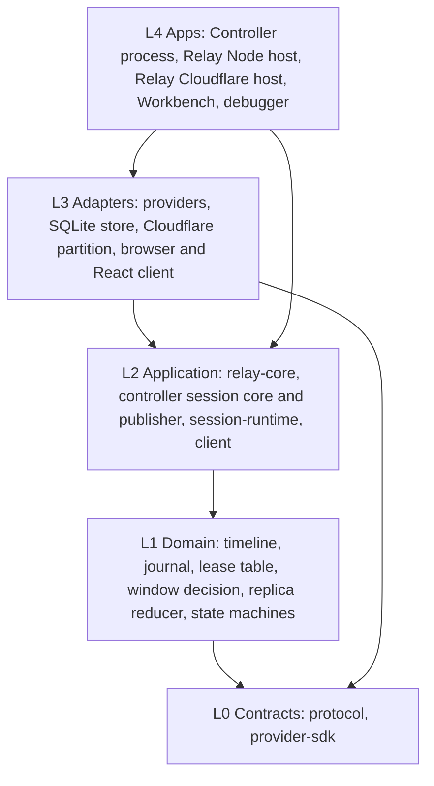

# Target architecture and test architecture

Status: design for the owner's decision, 2026-11-18. Analysis and target only; no code was changed.
Baseline: tag `baseline/im-session-2026-11-18` on `design/im-session-service`.
Inputs: [module boundaries and test layers](2026-11-17-module-boundaries-and-test-layers.md) (the assessment; its X1 to X9 and Q1 to Q9 are used by name), [IM session service design](2026-11-15-im-session-service-design.md), [journal simplification](2026-11-16-journal-simplification.md), and the plans S1 to S6a.
Quick wins already landed before this document (read from the repository): `workspaceSource` Vite alias to `src`, `pnpm test:unit <package>`, `pnpm task:start` with a task-based `verify:changed`, the Controller `process` Vitest project, `.test.tsx` files that need no DOM running in `node`.

## The owner's goal and model

"为当前的项目梳理出更加合理的抽象，使得修改影响到的测试范围也合理，组件内的测试要有单元测试，单元测试要有mock data，组件和组件之间要有集成测试，也是靠mock data，e2e测试其实不用太多，主流程覆盖到就可以。smoke test可以有，就类似于我们现在的本地测试，只是模拟的更加极端。目前的问题是修改代码影响到的测试范围太大，测试的时间有太长，很多冗余测试的同时，测试也没有章法，必须要梳理清晰，配合这件事情要梳理项目的抽象概念和结构。"

"项目的架构和模块可以为了层次更清晰而重构" (the owner, later the same day). This document therefore designs the target as it should be, and sequences the move to it in small steps. Package renames and splits are allowed where they make a layer or a dependency direction clearer. The public Remote protocol and the Provider SDK stay as the stable published boundaries; changes to them follow the upgrade rule (compatibility only through an upgrade, and the owner updates every Controller).

The house model, which every rule below serves:

- Every component has a purpose designed before assembly, so it is tested alone with mock data: a **unit test**.
- How components connect is specified in advance, so each connection is tested with mock data against that specification: an **integration test** of a **seam**.
- **E2E** covers the main flows and the cases that local real-world testing found. **Smoke** tests are `pnpm local` with real CLIs and a real browser, under more extreme conditions.
- Redundant tests mean an unclear module division: extract the missing module. A mock-data test over 1 s is wrong; over 300 ms needs a look.

## 1. Layers and rules

### 1.1 Layers

| Layer | Contains | May import |
|---|---|---|
| L0 Contracts | Public wire protocol, Provider SDK port | Nothing in the workspace |
| L1 Domain | Pure rules: timeline projection, the journal, lease and window decisions, replica reduction, send and succession state machines | L0, L1 |
| L2 Application | Use cases that own state behind ports: Relay core, Controller session core and publisher, session runtime, client connection and session client | L0, L1, L2 (by public entry) |
| L3 Adapters | One technology implementing a port: providers, SQLite and Cloudflare stores, Node and Workers hosts, browser and React bindings | L0, L1, L2 of the package that declares the port |
| L4 Apps | Composition roots and entry points: Controller process, Relay hosts, Workbench, debugger CLI | Any lower layer |
| Test support | Mock data, seam tests, e2e and smoke | Anything, through public entries |

A "port" is an interface declared by the application module that needs it (`JournalStore`, `AccountStateStore`, `Scheduler`, `RelaySocket`, `Clock`, `ProviderFacade`, `RelayLink`, `DeviceDatabase`, `Transport`). The adapter implements it; the application never imports the adapter.

### 1.2 Rules

Each rule is checked by `pnpm arch:check` (section 5.9) and fails the build.

1. **Direction.** Imports run down the table only. A package imports another only through its `exports` map; no deep imports, no relative paths across packages, no `dist` paths.
2. **Contracts are leaves.** Protocol and SDK import nothing from the workspace. Types that two sides share (controller location, diagnostics, session-relation, star and error schemas) live in the protocol, never in a Relay or Controller package.
3. **The domain is pure.** No `node:*`, DOM, timers, `Date.now`, `Math.random`, sockets or storage. Time and ids are injected values; decisions return effects as data.
4. **Application modules own state behind ports.** One module owns each piece of mutable state; others receive it through a port or a function. No `Map` or `let` shared by closure across concerns.
5. **Adapters implement one port family and know one technology.** They never import each other. Provider adapters import only the SDK and their native client library.
6. **The Relay does not know the Controller or the client.** Relay core never imports providers, the session runtime, the Controller or the client library.
7. **The Controller does not know the Relay's code.** It talks to the Relay only through the protocol and its own `RelayLink` port. It names concrete providers only in `providers.ts`, its composition root.
8. **The client does not know the Relay or the Controller.** It imports the protocol only. The headless client imports no React, DOM, IndexedDB or global `fetch`; those are adapter ports.
9. **Native runtime interpretation lives in adapters.** Controller modules that act on provider identity (succession, native owner) read SDK types only.
10. **Composition roots wire and do not decide.** A root is under 900 lines and holds no rule state.
11. **Test support crosses layers only through public entries.** A test never reads another package's files by path. Mock data comes from the owning package's `./testing` entry or from `agent-remote-fixtures`.
12. **A rule has one owner.** If the same rule is asserted in the unit tests of two modules, one of them is not the owner; move the rule or the test (section 5.8).

## 2. Glossary

Each term has one meaning and one owner module (target names, section 3). "Retired" names stay in old code until the migration step that renames them; new code and documents use the chosen name.

### 2.1 Deployment and roles

| Term | Meaning | Owner | Decision |
|---|---|---|---|
| Relay | The service between browsers and Controllers: accounts, bindings, journals, control leases, outbox, sharing | `agent-relay-core` | Gateway is only its HTTP edge module; Broker is retired: `createHostBroker` becomes `createRelay` |
| Host | A machine registered at the Relay: `hostId`, capabilities, binding to an account. A record, not a process | relay-core `host-session` | One meaning. Never used for the process |
| Controller | The process on a Host that runs providers and keeps the uplink | `agent-controller` | Retires "agent host", `createAgentHostRuntime` (becomes `createController`) and the directory name `agent-host` |
| Uplink | The Controller's one authenticated socket to the Relay | protocol `remote-host-uplink` | |
| Provider adapter | Implementation of the SDK port for one native runtime; owns all native interpretation | `agent-provider-*` | |
| Native session | The provider's own session record and id (a Codex thread, a Claude session file) | the adapter | |
| Session | The public session: `[hostId, providerId, nativeSessionId]` (`SessionIdentity`) | protocol | `agentId` is a Controller-local handle to a runtime; no new code calls a session an "agent" |
| Runtime | The resident adapter handle for a session on a Controller (`AgentSession`); absent while the session sleeps | `agent-session-runtime` | |
| Native owner | Who holds the native session now: a terminal (`native_cli`) or the Controller. Detected by the Controller, held by the Relay as a per-stream fact | controller `native-owner` | |
| Control lease | The Relay-issued right of one browser stream to mutate a session: `revision`, `token`, `access`, `available` | relay-core `session-control` | One owner after S5; the lease registry in the runtime package is direct-serve only |
| Take over | A person interrupts a terminal owner and attaches the Controller | controller `native-owner` | Not "succession" |
| Succession | Moving a conversation to another provider or native session, keeping its identity in the Workbench | controller `succession`, relay-core `succession-associations`, client `succession` | "Handoff" survives in product text only |
| Pairing key | A temporary, process-local credential that binds a Controller or browser | relay-core `pairing-keys` | |

### 2.2 Conversation data

| Term | Meaning | Owner | Decision |
|---|---|---|---|
| Row | One provider-level canonical timeline row (`CanonicalTimelineRow`) before folding | `agent-timeline` | |
| Item | The folded unit a reader sees (a message, a tool call, reasoning), made of rows | `agent-timeline` | |
| Item key | The stable identity of an item across reopen, assigned by the adapter (`ProviderItemIdentity.key`); also the client's row key | SDK (type), `agent-timeline` (use) | Retires row source keys and `${epoch}:...` keys |
| Timeline | The ordered projected entries of a session as a client reads them (`ProjectedTimelineEntry`) | protocol (shape), `agent-timeline` (projection) | |
| Journal | The Relay's durable store of one session's items, in sequence, under a generation and an epoch | `agent-remote-journal` | One journal per session |
| Epoch | One rewrite-free run of a journal's sequence; a replacement starts a new epoch | journal | Not a generation |
| Generation | The fencing number of the current publisher connection; a stale generation cannot write | journal | |
| Sequence | Dense position within an epoch (negative for prepended older history) | journal | |
| Item window | The newest bounded run of items a Controller offers on open; the Relay answers unchanged, append or replace | journal `window-decision` | The bare word "window" is not used for this; code names it `ItemWindow` |
| Head | The latest Snapshot the Controller published plus presence the Relay computes | journal | |
| Snapshot | The display state of a session: status, pending interactions, usage | protocol | |
| Publisher | The Controller module that offers item windows and live rows to the Relay journal | controller `publisher` | |
| Stream | One session's live feed over one connection. Qualified as the browser's session stream or the Relay-Controller host stream | relay-core `journal-service` and `edge` | |
| Outbox | The Relay's durable per-session queue of operations accepted for a Host that is offline or busy | relay-core `session-outbox` | The client's list of unsettled sends is **pending messages**; `message-outbox.ts` is renamed |
| Replica | The client's in-memory copy of a session's timeline and Snapshot, built by absorbing frames | `agent-client` `replica` | |
| Device store | The replicas' newest windows persisted on the device, keyed by Relay URL and session | `agent-client` `device-store` | "Cache" is not a noun for it |
| Renderer | The views that draw replica selectors | `agent-client-web`, Workbench views | Trace and Replica Inspector are diagnostics over the same state |

### 2.3 Product

| Term | Meaning | Owner | Decision |
|---|---|---|---|
| Group | One grouping of sessions: today's Window document. Window mode shows it as a Window; Bot mode as a roster group | protocol `window-workspace`, Workbench `state` | Product word Group; the code and protocol keep `window-workspace` and the `bots` appearance until a protocol change |
| Window mode, Bot mode | The desk (panes, details) and the team chat (roster, Content only) over the same groups | Workbench `views` | |
| Bot | A long-lived identity in a group: name, picture, role tag, one conversation | Workbench `state` | A session is at most one bot |
| Role tag, Ask, Side | Derived position label; a side discussion owned by one bot; a session forked from a source | Workbench `state` | |
| Live, Folded, Asleep | Subscription states of a bot in a large group | Workbench `state` (live budget) | |
| Team | A Leader and members created from a bot; Relay routes messages among them | controller `team`, relay-core `teams` | Not an account team |
| TPM, Support | A scheduled main-session service; a Call For Support coordinator | controller `tpm`, relay-core `support` | |

### 2.4 Test words

| Term | Meaning | Owner |
|---|---|---|
| Builder | A function that constructs mock data from overrides: `buildTimelineEntry({ ... })` | the owning package's `./testing` |
| Recording | A capture of a real provider CLI, with its CLI version, plus the golden rows it must produce | `agent-provider-*/recordings` |
| Transcript | A normalized JSON-lines capture of one wire scenario, with direction and logical time | `agent-remote-fixtures` |
| Vector | A decision table (`input`, `expected`) for one pure function | `agent-remote-fixtures/vectors` or the module's `./testing` |
| Seam | A written connection contract between two modules, named S1 to S7 (section 4) | `docs/current/agent-remote/seams.md` (written in M1) |
| Scenario | An ordered, named script reused by transcripts, e2e flows and smoke | `agent-remote-fixtures/scenarios` |

## 3. Target module structure

### 3.1 Packages

Names are decided once. A rename moves a directory and rewrites imports in one mechanical commit with no logic change (steps M2, M3, M7, M12).

| Target package | Today | Layer | Purpose |
|---|---|---|---|
| `agent-remote-protocol` | same | L0 | Public wire: messages, codecs, schemas, versions, shared model types |
| `agent-provider-sdk` | same | L0 | The provider port, observation types, conformance suite, recording format |
| `agent-timeline` (new) | `agent-remote-relay/src/timeline-projector.ts`, the pure part of `timeline-store.ts` | L1 | Rows and items, projection to entries, item identity |
| `agent-remote-journal` | same | L1 | The session journal, window decision, pages, retention, store port and memory store |
| `agent-relay-core` | `agent-remote-hosted` | L2 | The Relay: concerns, ports, HTTP and socket edge, `createRelay` |
| `agent-session-runtime` | `agent-remote-relay` | L2 | The Controller's runtime registry, session wire, operation settlement, provider registry |
| `agent-controller` | `agent-host` (manifest name already `agent-remote-controller`) | L2 and L4 | Session core, publisher, succession, native owner, TPM, Team; the process shell in `process/` |
| `agent-client` (new) | `agent-remote-web` `client/`, `replica/`, `headless`, device store logic | L1 and L2 | The headless client: connection, session client, replica, send and succession state machines, device store |
| `agent-client-web` | `agent-remote-web` `react/`, `browser`, `styles.css` | L3 | React views and hooks, IndexedDB `DeviceDatabase`, WebSocket `Transport` |
| `agent-provider-claude`, `-codex`, `-copilot`, `-opencode`, `-dsh`, `codex-daemon-client` | same | L3 | Native adapters |
| `agent-remote-journal-sqlite` | same | L3 | `JournalStore` over SQL |
| `agent-relay-node` (new) | `agent-remote-lab/src/server` (Gateway, local authorizer, devbox, static serving, SQLite binding) | L4 | The Node host of the Relay for `pnpm local`, self-hosted and the standalone Workbench |
| `agent-relay-cloudflare` | `agent-remote-cloudflare` | L4 | The Workers host: Durable Objects, partition, storage envelope |
| `agent-workbench` | `agent-remote-lab` `src/` (the app) | L4 | The Workbench |
| `agent-remote-debugger`, `agent-remote-dsh`, `agent-remote-tunnel`, `agent-platform` | same | L3 and L4 | Unchanged: debugger CLI, DSH plugin, tunnel, platform helpers |
| `agent-remote-fixtures` (new, private) | `agent-remote-protocol/test/fixtures` plus every inline wire example | test support | Wire transcripts, vectors, scenarios, builders and players |
| `agent-remote-seams` (new, private) | cross-package integration tests spread over host, hosted, lab, cloudflare | test support | Seam tests S1 to S7 only; no `src` |
| `agent-e2e` (new, private) | `agent-remote-lab/e2e` flows, `performance/` proxy and scripts | test support | Stack launcher, main-flow e2e, smoke, fault injection |

Decisions on names:

- **`agent-remote-relay` is renamed `agent-session-runtime`.** It is the Controller-side session manager, and its name made the Relay package graph unreadable. It is published (0.1.1), so the rename publishes a new name and leaves the old one deprecated; the owner decides when to publish.
- **`agent-remote-hosted` is renamed `agent-relay-core`.** "Hosted" says nothing; the package is the Relay. `agent-relay-node` and `agent-relay-cloudflare` are then its two hosts, symmetrical.
- **`agent-remote-web` is split in two.** Its export map already separated `headless` from `react` and `browser`; two packages make "the client core imports no React or DOM" a graph fact. The published name `agent-remote-web` is deprecated in favour of `agent-client-web`.
- **`agent-remote-lab` is split in three** (Workbench, Node Relay host, e2e) because it is three things in one package. The name `lab` ends with the split.
- **Not renamed:** `agent-remote-protocol`, `agent-provider-sdk` (stable published boundaries), the provider packages, `agent-remote-journal`, `agent-remote-journal-sqlite`, `agent-remote-tunnel`, `agent-platform`, `agent-remote-debugger`.
- **`dist` exports.** Published artifacts stay `dist`. Everything inside the workspace resolves to `src`: Vitest and Vite already do (`workspaceSource`); builds and typecheck use TypeScript project references, so a dependent never type-checks against a stale `dist`.

### 3.2 Modules inside each package

Every package lays out `src/` by layer: `domain/` (pure), `app/` (ports and use cases), `adapters/` or `edge/` (technology), `testing/` (the `./testing` entry), and a root composition file. Tests sit beside the module they test. "Must not know" is checked by `arch:check`.

#### Contracts and domain

| Module | Purpose | Public interface | Depends on | Must not know |
|---|---|---|---|---|
| protocol `wire/` | Messages of the uplink, journal, session channel, session control, outbox, succession | Typebox schemas, guards, `PROTOCOL_VERSION` | nothing | any runtime, any package |
| protocol `model/` | Timeline entry, Snapshot, session identity, window workspace, Team, shared schemas moved from hosted and relay (controller location, diagnostics, relation, star, errors) | types, guards | nothing | |
| protocol `codec` | Encode, decode, envelope limits | `encode`, `decode` | `wire`, `model` | |
| SDK `port` | `AgentProviderAdapter`, `AgentSession`, observations, `ProviderItemIdentity` | types | nothing | Controller, Relay |
| SDK `conformance` | The shared contract suite every adapter runs against its recordings | `runAdapterConformance(adapter, recordings)` | `port`, `recording` | any concrete provider |
| SDK `recording` | Recording format, recorder, replayer, scripted adapter | `recordSession`, `replayRecording`, `scriptedAdapter` | `port` | |
| `agent-timeline` `projector` | Rows to items to entries, key assignment | `entryFromRow`, `mergeRowIntoEntry`, `projectRows` | protocol, SDK types | storage, sockets |
| `agent-timeline` `timeline-store` | Ordered rows with identity, folding | `createTimelineStore` | `projector` | providers, Relay |
| journal `session-journal` | Append, complete, alias, replace, prepend, head; generation fencing; contiguous sequence | `createJournal`, `apply(entry)` | protocol, timeline | clock (injected), store, sockets |
| journal `window-decision` (X3) | `decideWindow(tail, newest)` returns `unchanged`, `append` or `replace`; trims a replacement to budget | pure function | `item-digest` | I/O |
| journal `pages`, `retention` | Tail, before and after pages; eviction and fill | `page`, `evict` | `session-journal` | |
| journal `store` | `JournalStore` port, memory store, store conformance suite | port, `memoryJournalStore`, `runStoreContract` | | SQL, Workers |
| relay-core `domain/session-control` (X2) | The lease transition table: acquire, hold, release, refuse with a reason, Host offline, native owner | `transition(state, event)` returns state and reply | protocol | sockets, clock |
| relay-core `domain/host-lifecycle` | Heartbeat deadlines and expiry decisions | `nextHostState(state, event, now)` | protocol | |
| relay-core `domain/rules` | Pure rules of outbox ordering, succession association validity, relation and star validation | functions | protocol | |
| client `replica` | Reducer split in four: `absorb-window` (a replacement by item key), `page-fold`, `pending-messages`, `snapshot-apply` | `reduce(state, frame)`, selectors | protocol | React, DOM, transport |
| client `send-state` (X8) | `transition(state, event)` over idle, pending, queued, delivered, uncertain, failed; `describe(state)` | pure | | |
| client `succession` (X1) | `reduce(state, event)` returns state and effects as data | pure | protocol | |
| client `lease-view` | Maps lease and refusal frames to the view reasons, one table | pure | protocol | |

#### Application

| Module | Purpose | Public interface | Depends on (ports) | Must not know |
|---|---|---|---|---|
| relay-core `host-session` (X5) | One Host connection: register handshake, capabilities, heartbeat, expiry, rpc | `createHostSession({ socket, scheduler, state })` with `onMessage`, `tick` | `Scheduler`, `RelaySocket` | other concerns' state |
| relay-core `journal-service` | Journal open, publish, fills, older history, served streams | `createJournalService({ store, scheduler })` | `JournalStore`, `Scheduler`, `window-decision` | Cloudflare, Node |
| relay-core `session-outbox` | Durable queue, claim, settle | `createOutbox(state)` | `AccountStateStore` | sockets |
| relay-core `account-state` | Drafts, reads, stars, titles, favorites, relations, windows and groups | one `createX(state)` per feature | `AccountStateStore` | |
| relay-core `pairing-keys`, `bindings` | Pairing, device keys, bindings, creations | `createPairing`, `createBindings` | `Clock`, `Ids` | |
| relay-core `succession-associations`, `teams`, `support`, `sharing`, `previews`, `releases` | Concerns extracted from the broker (X6) | `createX(state, ports)` | | each other |
| relay-core `edge` | HTTP auth and routing, session channel sockets, `Gateway` | `createEdge(relay)` | `RelaySocket` | rules (it calls concerns) |
| relay-core `relay.ts` | Composition: `BrokerState`, concerns, edge (today `broker.ts`) | `createRelay(ports)` | all concerns | under 900 lines |
| session-runtime `agent-manager` | Runtime registry, attach, send, operation settlement, journal tap | `createAgentManager({ providers, clock })` | SDK port, timeline | Relay, journal, uplink |
| session-runtime `session-wire` | The session wire for direct-serve and the Controller's host streams | `serveSessionWire` | `agent-manager` | |
| controller `session-core` (X9) | Catalog, attach, create, binding, outbox delivery, directory, publication wiring | `createSessionCore({ providers, relayLink, clock, store })` | `ProviderFacade`, `RelayLink`, `Clock`, `StateStore` | Relay code, processes |
| controller `publisher` | Item windows and live rows to the journal; backoff; recovery by reopen | `createPublisher({ uplink, source })` | `JournalUplink`, `SessionTimelineSource` | the Relay's journal internals |
| controller `succession`, `native-owner`, `tpm`, `team`, `directory` | Rules over SDK types | `createX(ports)` | `SessionCore` ports | provider specifics |
| controller `uplink-client` | Registration mirror, heartbeat, rpc, reconnect | `connectUplink(relayLink)` | `RelaySocket` | rules |
| client `connection`, `session-client` | Transport, reconnect, session channel, lease and pending-message ledger | `createSessionClient({ transport, store })` | `Transport`, `DeviceStore` | React, DOM |
| client `device-store` | Window records, write-behind, restore, eviction, version discard | `createDeviceStore(database)` | `DeviceDatabase` | IndexedDB |
| Workbench `state` (X7) | Groups, selection, cached versus authoritative content, recovery notice, draft ownership | `reduce(state, event)`, selectors | client | React |
| Workbench `views`, `hooks`, `App.tsx` | Rendering; effects; composition under 800 lines | components | client-web | Relay, sockets |

#### Adapters and apps

| Module | Purpose | Notes |
|---|---|---|
| `agent-provider-*` | One native runtime each: observations with item identity, history reads, recordings | Imports SDK only; exports `./recordings` and `./testing` |
| `agent-remote-journal-sqlite` | `JournalStore` over a SQL port | Runs the store conformance suite |
| `agent-relay-node` | `node:http` and `ws` host, SQLite binding, static files, local authorizer, devbox | The only package that opens a Relay listener |
| `agent-relay-cloudflare` | Worker, Durable Objects, `JournalPartition`, storage envelope | Runs the partition contract and a small `workers` suite |
| `agent-client-web` | React hooks and views, IndexedDB `DeviceDatabase`, browser `Transport`, CSS | Runs the device-database contract |
| controller `process/` | CLI, supervisors, systemd, Windows autostart, VS Code tunnel, update, Codex daemon runner | Own Vitest project |

### 3.3 What moves out of the big files

| Today | Extracted to | Lines |
|---|---|---:|
| `hosted/broker.ts` (2,737, one closure) | `host-session` (register, disconnected, expire, send, rpc: lines about 790 to 1,130), `succession-associations` (about 600), `pairing-keys` (about 300), `account relations` (250), `support` (250), `teams` (200), `sharing` and `previews` (150), `journal-deletion` (100), `session-control` (250, with `control.ts`), `BrokerState` as one explicit object; the rest becomes `relay.ts` | about 2,100 out, under 900 left |
| `hosted/gateway.ts` (1,222) | `edge/` (routes by concern: sessions, windows, pairing, releases) | stays, split by file |
| `host.ts` (1,807; `createAgentHostRuntime` about 1,350) | `session-core/` (catalog, attach and create and binding, outbox delivery, directory), `publication wiring` into `publisher/`, `succession wiring`, `uplink-client`, `process` composition into `controller.ts` | about 1,000 out, under 900 left |
| `lab/App.tsx` (3,765) | `state/workbench-state.ts`, `state/selection`, `state/recovery-notice`, `client/succession` (from `useSessionSuccession.ts` 1,152: about 700 move), `state/window-composition`; effects stay in `hooks/` | about 1,800 out, under 2,000 then under 800 after X7 slices |
| `web/replica/reducer.ts` (725) | `absorb-window`, `page-fold`, `pending-messages`, `snapshot-apply` | split |
| `web/client/remote-session-client.ts` (1,068) | `lease-view` table, `session-client` shell | split |
| `relay/timeline-projector.ts`, `timeline-store.ts` | `agent-timeline` | move |
| `hosted/{controller-location, relay-diagnostics, session-relations schema, session-star-schema, session-errors, favorites schema}` | `agent-remote-protocol/model` | move |
| `host/test-utils/recordings.ts` (reads provider directories by relative path) | provider `./recordings` exports | removed |
| `lab/src/server/*` (2,739), `performance/latency-proxy.mjs` | `agent-relay-node`, `agent-e2e/faults` | move |
| `lab/src/server/recorded.ts` (recorded-scenario server) | `agent-remote-fixtures/scenarios` serving the same scenarios to component tests | move |

## 4. Seam contracts

A seam has three artefacts that M1 creates and every later step keeps true: a written contract (`docs/current/agent-remote/seams.md`, one section per seam, linking the protocol and the plans), a fixture set that both sides consume, and a small integration suite in `agent-remote-seams` (or in the owning package when both modules sit in it). Integration tests run real modules inside the seam and fixtures or in-memory ports outside it. They never start the whole stack.

How fixtures are produced:

- **Recordings** are captured from real CLIs by the native tier (`pnpm record:provider <name>`), with the CLI version in the header, and re-recorded on a provider upgrade. The golden output next to each recording is produced by the projector and reviewed once.
- **Transcripts** are captured from a run of the real Controller session core and the real Relay in one process over a `RelaySocket` pair (`pnpm transcripts:record <scenario>`), normalized (ids, times and tokens become placeholders), and committed. M1 records them at the baseline tag, so they pin today's behaviour.
- **Vectors** and **builders** are constructed by hand, as tables and functions.
- `pnpm fixtures:check` verifies headers, that each transcript's protocol version equals `PROTOCOL_VERSION`, and that no fixture is unused. A protocol change fails until the transcripts are regenerated and reviewed in the same commit: that one diff is the review of the wire change.

### S1 Adapter to Controller rows

- **Parties.** A provider adapter (SDK port) and `agent-session-runtime` with `agent-timeline`; the publisher's `SessionTimelineSource` is the output.
- **Contract.** `AgentProviderAdapter.open` yields `ProviderStreamItem`: `ProviderObservation` (event plus `ProviderItemIdentity { key, completes, liveOnly }`), `ProviderHistoryBoundary` and `ProviderTimelineReplacement`. The runtime projects them to canonical rows with item keys; `loadOlderHistory` returns older rows.
- **Guarantees.** (1) An item has the same key live and when reread after a reopen. (2) History read at open holds every item that is not `liveOnly`. (3) Observations of one session arrive in order; `completes` ends an item. (4) Native interpretation stays in the adapter: the runtime sees only SDK types.
- **Errors.** Adapters raise typed provider errors (unavailable, native owned, unsupported), never a raw native failure. An identity breach makes the publisher unserve the journal.
- **Fixtures.** `agent-provider-<name>/recordings/*.json` with `*.rows.json` golden rows. Today: Claude 18, Codex 12, Copilot 8; OpenCode and DSH get scripted ones.
- **Integration tests** (`seams/S1`, about 40, each under 100 ms): each recording replayed twice (live, then reread) yields equal keys and the golden rows; older-history pages continue the sequence; an identity breach is reported. The conformance suite itself is a contract test inside each provider package.

### S2 Controller to Relay uplink

- **Parties.** Controller `uplink-client`, `session-core` and `publisher`; Relay `host-session` and `journal-service`.
- **Contract.** `remote-host-uplink`: register with capabilities (the Relay requires `control`), heartbeat, rpc with request ids, outbox offers, claims and settlements, native owner reports. `remote-host-journal`: `journal_open` carries the item window; the Relay answers `journal_opened` with generation, watermark and the outcome (unchanged, appended or replaced); `journal_publish` carries entries with generation and sequence; the Relay acknowledges each batch or sends a refusal with a reason; fills and older history are requests with a 15 s deadline; `journal_unserve` stops serving.
- **Guarantees.** Sequences are contiguous per generation and a refused entry consumes none. An acknowledgement means durable. A stale generation is fenced. After any failure the Controller reopens with a new window; there is no other recovery. The Relay never synthesizes runtime state.
- **Errors.** The refusal reasons of `remote-host-journal` (for example `sequence_gap`, `quota_exceeded`, `incomplete`) and registration refusals (version, revoked Host). Each has one transcript.
- **Fixtures.** `agent-remote-fixtures/transcripts/uplink/*.jsonl`: register and heartbeat expiry; attach and open with unchanged, append and replace; publish refusal per reason; offline Host with outbox; control refusal by native owner; reconnect and reopen.
- **Integration tests.** Controller side (in `agent-controller`, contract tests): the publisher and `uplink-client` against a transcript player that plays the Relay; the frames sent equal the transcript's Controller frames. Relay side (in `agent-relay-core`): `host-session` and `journal-service` against a player that plays the Controller. Seam (`seams/S2`, about 12): the real Controller session core with a scripted provider from a recording, the real Relay with memory stores, over a `RelaySocket` pair; the resulting transcript equals the golden. About 40 tests in all.

### S3 Relay to browser session wire

- **Parties.** Relay `edge` and `journal-service`; client `connection` and `session-client`.
- **Contract.** `session-channel` and `session-control` frames. The client opens with a cursor and the item-key flag. The Relay sends the Snapshot first, then timeline pages and live entries (entries carry item keys), `timeline_replacement` with a new epoch and the whole window, and `agent_update`. The client sends `session_control` acquire and release; the Relay answers each acquire with a lease frame carrying its request id, revision and token; every mutation carries the token.
- **Guarantees.** Pages are contiguous within an epoch. A replacement is complete in one frame set. The lease is issued only by the Relay. A mutation reaches a Controller only from a stream with a live lease, and the Controller refuses it if a terminal owns the session.
- **Errors.** Lease refusals (`read_only`, owned, offline, restoring), close code 4029 for capacity, a 4xx that leaves the stream reading, offline Host answered from the journal.
- **Fixtures.** `transcripts/session-wire/*.jsonl`: fresh open; reconnect from a cursor; replacement; append; acquire granted, refused, taken over; offline Host; quota trim. The same files serve both ends.
- **Integration tests.** Client side (`agent-client`, contract, about 30): the session client against a transcript server. Relay side (`agent-relay-core`, contract, about 30): the Relay against a scripted client. Seam (`seams/S3`, about 12): real client and real Relay with memory stores and a scripted Controller transcript. Transport (`*.transport.test.ts`, 6): `agent-relay-node` and `agent-client-web` over a real loopback WebSocket, because AGENTS.md requires real transports for protocol, pairing and reconnect changes.

### S4 Relay to stores

- **Parties.** relay-core `journal-service` and `account-state`; `JournalStore` and `AccountStateStore` implementations.
- **Contract.** `JournalStore`: load, persist batch, list, delete, with per-Host ordering. `AccountStateStore`: atomic `commit(state)` and `restore()` of a versioned envelope (the broker's `commit` and `committedBrokerState` path). Persist is durable before it returns. Size limits raise a typed `StoreLimit`.
- **Fixtures.** Operation vectors in the two `./testing` entries (the store conformance suites).
- **Integration tests.** The memory store, `journal-sqlite` and the Durable Object storage run the same suite (about 40 cases each, in memory, under 50 ms). Relay concerns run once against the memory store inside `agent-relay-core`. The Worker proves persistence only.

### S5 Relay to Cloudflare partition

- **Parties.** relay-core's partition proxy and `agent-relay-cloudflare`'s `JournalPartition`.
- **Contract.** `journal-partition.contract.json`: `capabilities`, `open`, `publish`, page and fill calls, with replies halved to stay under 24 MiB, per-Host ordering and a capability retry every 30 s.
- **Fixtures.** The contract JSON, regenerated from the in-process partition; size vectors for the halving.
- **Integration tests.** The proxy against a contract player (relay-core, unit speed). The partition server against the same contract through an in-process Node implementation, with no `workerd` (about 15). The `workers` project keeps at most 20 tests that need the Workers runtime: socket upgrade, alarms, storage envelope chunking at 256 KiB, Durable Object eviction. Cloudflare total under 25 s.

### S6 Client replica to renderer

- **Parties.** `agent-client` `replica` and the views of `agent-client-web` and the Workbench.
- **Contract.** The renderer reads selectors only: `selectTimeline(session)` gives rows keyed by item key, `hasOlder` and `epochPending`; `selectSessionView(session)` gives status, lease view and the send-state words. It issues commands: `send`, `loadOlder`, `acquire`, `retry`. Views never read frames or raw state. Selectors return the same object when content is equal.
- **Guarantees.** Keys are stable across a replacement; unchanged rows keep their identity; the reader's anchor survives a replacement.
- **Fixtures.** `buildReplica({ ... })` and `replicaAfter(transcript, frame)` in `agent-remote-fixtures`.
- **Integration tests.** `seams/S6` (about 25): a transcript drives the real replica and the real React view with a fake client and no Relay; an unchanged row keeps its React identity across a replacement; a pending send maps to its words; a recovery notice appears and clears. Unit tests of views render builder states.

### S7 Device store to replica

- **Parties.** `agent-client` `device-store` and `replica`; `DeviceDatabase` as the port.
- **Contract.** `save(record)` and `restore(identity)` over `StoredRecord { key, relayUrl, version, epoch, nextSeq, hasOlder, entries, snapshot, updatedAt, bytes }`. Writes follow a settled batch, bounded by a byte budget with least-recently-used eviction. A restored record seeds the replica marked `restored` and is never authoritative; the first server page replaces it by item key. A version mismatch discards the record.
- **Fixtures.** `buildStoredRecord`; frozen `device-records/v<n>.json` for each stored version.
- **Integration tests.** The `DeviceDatabase` contract suite runs on the memory database, on IndexedDB through `fake-indexeddb` (`agent-client-web`) and in the browser component tier (3 tests). `seams/S7` (about 15): open, save, restart, restore, absorb the server tail, version discard, budget eviction.

### Seam summary

| Seam | Real modules | Everything else | Tests |
|---|---|---|---:|
| S1 adapter to rows | adapter conformance, runtime, timeline | recordings | 40 |
| S2 uplink | Controller session core and publisher, Relay host-session and journal-service | transcripts, memory stores, `RelaySocket` pair | 40 |
| S3 session wire | client, Relay edge and journal-service | transcripts, memory stores | 80 |
| S4 stores | each store implementation | vectors | 120 |
| S5 partition | proxy, partition server | contract JSON | 35 |
| S6 replica and renderer | replica, views | transcripts, fake client | 25 |
| S7 device store | device store, replica | memory database | 25 |

About 365 seam tests. They are new and narrow; each migration step deletes the old tests they replace (section 6).

## 5. Test architecture

### 5.1 The tiers

| Tier | Suffix and place | Vitest project | May use | Forbidden | Budget per test | Runs |
|---|---|---|---|---|---|---|
| Unit | `*.test.ts(x)` beside the module | `unit` | One module through its public functions; ports replaced by stubs; builders | Sockets, processes, `workerd`, real timers over 50 ms, real clock, files outside a temp directory, another package's files | 300 ms looks; 1 s fails | Every task |
| Contract | `*.contract.test.ts` beside the module that consumes the fixture | `contract` | A module and a transcript, vector or recording player | Same as unit | Same | Every task, and after a contract change in every consumer |
| Integration | `*.integration.test.ts` in `agent-remote-seams/tests/S<n>/`, or beside the modules when one package holds the seam | `integration` | Two or more real modules, in-memory ports, `RelaySocket` pair, fake scheduler | Whole stack, real listeners, processes | Same | After a change on the seam |
| Transport | `*.transport.test.ts` | `transport` | A real loopback socket on a free port, a real WebSocket | More than one Host or account; real CLIs | 2 s; at most 30 in the repository | After a protocol, pairing or reconnect change |
| Process | `*.process.test.ts` | `process` | Child processes, real timers (Controller shell) | Relay logic | 15 s; one worker | When `controller/process/` or scripts change |
| Workers | `*.workers.test.ts` | `workers` | `workerd` | Rules | 5 s; at most 20 | When the Cloudflare host changes |
| Component (browser) | `e2e/components/*.spec.ts` in the Workbench and client-web | Playwright, fixture page | Builder states, no Relay | A Relay, a Controller | 5 s | After a CSS, layout or component change; at step end |
| E2E flows | `agent-e2e/flows/*.spec.ts` | Playwright | Real browser, Relay, Controller, scripted provider | Real models | 30 s | End of a step, before merge or release |
| Smoke | `agent-e2e/smoke/*.ts` | `pnpm smoke` | Real CLIs, real browser, fault injection | None | minutes | On demand, before release |
| Native | `*.local.test.ts` | `local` | A real CLI and model | | 60 s | By hand or nightly |

Only e2e, smoke and native use a real stack. Unit, contract and integration tests never start a listener or a process and never read the clock or the home directory; the ports (`Scheduler`, `Clock`, `RelaySocket`, `JournalStore`, `DeviceDatabase`, `Transport`) exist for that.

### 5.2 Unit tests

- **Location.** Beside the module: `src/<layer>/<module>/x.ts` and `x.test.ts`. A module's tests are its own; nothing else imports them.
- **Naming.** The test file names the public function or rule it covers. A table-driven test loads vectors (`it.each(vectors)`); a state machine has one table and one test over it. A file has at most 400 lines and one `describe` per rule.
- **Environment.** `node`. A file that renders DOM declares `// @vitest-environment jsdom`; only `agent-client-web` and Workbench `views` may.
- **Time.** `FakeClock` and `FakeScheduler` from the package's `./testing`. `vi.useFakeTimers` is allowed; a real timer over 50 ms is not.
- **What a unit test never does.** Open a socket, spawn a process, start `workerd`, wait on the wall clock, read a provider directory or another package's files.

### 5.3 Mock data conventions

1. **Four kinds, four homes.** Builders and fake ports live in the owning package's `./testing` entry (for example `buildTimelineEntry`, `buildSnapshot`, `memoryJournalStore`, `FakeScheduler`, `socketPair`). Wire transcripts, vectors, scenarios and replica-state builders live in `agent-remote-fixtures`. Recordings live in each provider's `./recordings`.
2. **Builders construct, deterministically.** `buildX(overrides)` returns a frozen value. Ids come from `sequentialIds('session')`, time from `TEST_NOW`; no `Math.random`, no real `Date.now`. A builder is the only place a default value of a shape is written.
3. **No ad hoc copies.** A shape that appears in three test files is a builder. `arch:check` flags an inline wire-message literal (an object with a protocol `type` value) in any test outside `agent-remote-fixtures` and the protocol package's own tests.
4. **Fixtures are immutable and headed.** JSON fixtures carry `kind`, `producedBy`, `protocolVersion` and the CLI version for recordings. Changing one is a reviewed diff.
5. **Recorded when real, constructed when not.** Anything the real system emits (provider output, wire frames) is recorded; decision tables and edge cases are constructed.
6. **Packages publish `./testing` only where they are layered below the test.** Public packages ship `./testing` for builders and fakes; recordings and transcripts never ship.

### 5.4 The speed rule and its enforcement

- **Hard limit.** Each of `unit`, `contract` and `integration` sets `testTimeout: 1000`. A test that is still running after 1 s fails.
- **The reporter.** `scripts/lib/test-budget-reporter.mjs` (a Vitest reporter) reads each test's measured duration. It fails the run when a unit, contract or integration test took over 1 s (this also catches a CPU-bound synchronous test that a timeout cannot interrupt), and lists those over 300 ms with file, name and project. `slowTestThreshold` is set to 300 so Vitest's own output agrees.
- **A ratchet.** `docs/superpowers/specs/test-metrics.json` records the count over 300 ms per project. The reporter fails when the count rises, and the number only goes down. A test between 300 ms and 1 s needs a comment naming why it cannot be faster, or it is fixed.
- **The guards.** A setup file for the three mock-data projects replaces `net` listen and connect, `child_process`, `node:dns` and `setTimeout` over 50 ms (unless fake timers are on) with functions that throw "not allowed in a unit test; this belongs in the transport or process tier".
- **Deadlines.** The per-test deadlines above and the outer process deadlines in `scripts/run-tests.mjs` apply to every project and command. Each new command gets both.
- **When slow means missing module.** A slow mock-data test usually shows a module that is not extracted (a closure that needs a whole Relay). The rule: do not raise the limit; open an extraction step.

### 5.5 Integration tests

Defined per seam in section 4: real modules inside the seam, mock data outside, in memory, never the whole stack. Rules:

- A seam test asserts the written contract (messages, order, guarantees, errors), not the neighbours' internals.
- Each guarantee in a seam's contract has at least one test; each error has a transcript.
- Both ends of a wire seam consume the same transcript. A protocol change updates the transcript once.
- Where a seam spans two packages, the test lives in `agent-remote-seams`, the only package that depends on both ends. Where one package holds both modules, the test lives there.
- Real transports are allowed only in the `transport` tier (about 6 for S3, 4 for pairing, 4 for Controller reconnect, 4 for the lease and take-over race, 12 others; 30 at most).

### 5.6 E2E: the main flows

Harness `agent-e2e/stack`: one `agent-relay-node` (SQLite in a temp directory), one Controller with a scripted provider that replays a recording, and the built Workbench, on free ports, started once per run and shared. Each test creates its own Host and session ids. Playwright runs the flows in sequence on one worker with a 30 s test deadline and a 4 minute global deadline. The scripted provider and the recordings make the flows deterministic.

| # | Flow | Tests | What each proves |
|---|---|---:|---|
| E1 | Pair and read: pair a Controller with a temporary key, see the Host online, open a session, read messages, tool calls, reasoning and markdown | 4 | Pairing; directory; conversation rendering primary; Trace opens |
| E2 | Send and reply: send, see pending then delivered, streaming reply, reload shows the same; send while the Host is offline is queued then delivered | 4 | Send-state words; outbox; echo by item key |
| E3 | Reconnect and return: socket drop, Controller restart, page reload with the device store paints at once then catches up; a journal replacement keeps the reader's place; older history loads on scroll | 5 | Replica absorb by item key; device store; S4 reading-anchor drift (one test); Codex older-history load (one test) |
| E4 | Terminal drives a session: a scripted native writer appends while the page is open; the page turns read-only, take over works; a terminal fork appears as its own session | 4 | Native owner; lease; Claude terminal fork (one test) |
| E5 | Succession: hand a session to another provider, the conversation continues, refresh in the middle recovers | 3 | Client succession model end to end |
| E6 | Groups and modes: build a group, Bot and Window mode, fold and sleep, a draft shared across modes | 4 | Group, bot membership, live budget, drafts |
| E7 | Share and Team: share a Host session, create a Team from a bot, a read-only recipient cannot send | 3 | Grants, Team delivery, lease refusal |
| E8 | Update a Controller | 1 | Release metadata and the update flow |

**Target: 28 e2e tests** (24 to 32), about 4 minutes, from about 400 e2e and browser tests today. Local findings enter the list only as one e2e test each, with the unit or integration test that explains the defect (rule: section 5.7). The three named findings are marked above. Everything else in today's 93 specs moves down: layout and fixture-page specs (about 200 tests) become the **component tier** on builder states with no Relay (under 90 s in all, run on demand and at step end); behaviour specs are deleted after their lower-tier replacement passes a mutation check.

### 5.7 Smoke tests

Smoke is `pnpm local` made extreme: the instance of `.agents/skills/prepare-arc-local`, real Claude and Codex CLIs, a real Chrome, and faults. It reports; it does not gate a task. It is run on demand with `pnpm smoke <scenario> --seed <n>` and before a release (`pnpm smoke:all`, about 40 minutes; `pnpm smoke:quick`, three scenarios in about 5 minutes, before merging a change to a seam).

| # | Scenario | Fault | Invariants checked |
|---|---|---|---|
| M1 | Bad network | The latency proxy (extended with jitter, loss, half-open sockets, bandwidth cap) at 50, 300 and 1,500 ms round trip and 2 and 10 percent loss | First paint from the device store under 300 ms at any latency; every `clientMessageId` settles exactly once; no duplicate item key |
| M2 | Controller restart mid-turn | SIGKILL and graceful stop during streaming and during a tool call, 20 times | Journal sequences contiguous; one replacement at most per restart; the turn's rows are complete after return |
| M3 | Relay restart mid-turn | Restart the Relay with a SQLite journal; also with an empty store | Controller reopens; the page shows no blank frame and no stale label |
| M4 | Quota pressure | Tiny journal quotas, tool outputs of several MiB | The Relay trims a replacement to budget and reports it; live-only items survive; no refused-row hole |
| M5 | Many sessions | 200 sessions and a 50-bot group; open, fold, sleep, wake | Live subscriptions within budget; directory churn does not re-render rows that did not change; memory flat |
| M6 | Terminal races page | A real Claude and a real Codex terminal write while the page sends, 50 times each | The lease follows the native owner; no lost or doubled message; take over works; terminal rows appear in the timeline |
| M7 | Hidden page and drops | Chrome visibility `hidden`, then offline for 10 s to 10 min, then visible; repeated | Catch-up costs one tail request; no stale "reconnecting" label; draft and reading position kept |
| M8 | Soak | 30 minutes of streaming on three sessions | Row counts, heap and socket counts stable |

- **Faults are seeded** (`--seed`), so a failure replays. A fault schedule is a list of timed actions in the report.
- **Invariants are read from the wire and the page.** The proxy tees every frame into a transcript; the page exposes Replica Inspector data. A scenario fails on an invariant, not on a screenshot.
- **Reports.** `pnpm smoke` writes `.arc-local/smoke/<date>/report.json` (scenario, seed, schedule, measurements, invariant results, transcript path) and a one-page summary. Reports are not committed; findings are.
- **A finding becomes tests in this order.** (1) Keep the failing run's transcript and seed. (2) Add the transcript to `agent-remote-fixtures` and a failing integration test on its seam. (3) Add the failing unit test in the module that owns the broken rule (the invariant-to-module table in `modules.json` names it). (4) Fix. (5) Add an e2e test only if a main flow regressed or the failure is a visible local finding. Each smoke finding therefore leaves a transcript, an integration test and a unit test.

### 5.8 Native tier and redundancy control

- Native tests stay `*.local.test.ts` and opt-in: `pnpm test:local`, `pnpm test:claude`, `pnpm test:opencode:native`, `pnpm test:codex-shared`. They also run `pnpm record:provider`, which refreshes recordings on a CLI upgrade; a changed recording shows as a diff that the owner reviews.
- **Redundancy control.** A rule is tested in its owner module's unit suite and once on its seam. `arch:check --redundancy` lists rule-tagged test titles (`[control.refuse.owned]`) that appear in more than one module's unit tests, and counts test files per module that build a neighbour's whole closure. A hit means the rule has two owners or a module is missing; the answer is a move, not a new test. Deleting a duplicate needs the mutation check: break the rule, see the owner's test fail first, then delete.

### 5.9 The change-to-test mapping

`architecture/modules.json` declares, for every module: `paths` (globs), `layer`, `seams`, `flows` and `invariants`. `pnpm arch:check` fails when a source file belongs to no module or two modules, when a layer rule is broken, when a test file's suffix does not match its imports (a socket in a `*.test.ts`), and when an inline wire literal appears in a test.

`pnpm test:changed` (called by `verify:changed`) computes the plan:

1. The base is the task base (`pnpm task:start`, `$ARC_TASK_BASE`, then the merge base).
2. Each changed file maps to its module by longest path prefix.
3. For each changed module: its `unit` and `contract` tests (`vitest run --project unit --project contract <module paths>`), then the `integration` suites of the seams listed for it, then the `transport` and `process` projects only if their modules changed.
4. If the module is in L0 or in `agent-remote-fixtures`: the contract tests of every consumer of the changed message, found from the `consumers` field in the transcript headers, and all seam suites of that wire area.
5. Typecheck and build only the changed packages and their dependents (the existing `affected` filters).
6. It prints the flows the changed modules affect (`flows`) as a reminder. E2E and smoke never run automatically; the step-end gate runs them.

| Changed module | Runs |
|---|---|
| protocol `wire` or `model` | Protocol unit; contract tests of every consumer of the changed message; S2, S3 |
| SDK `port`, `conformance`, `recording` | SDK unit; every adapter's conformance; S1 |
| A provider adapter | That adapter's unit and conformance; S1 |
| `agent-timeline` | Its unit; S1, S6 |
| journal `session-journal`, `window-decision` | Its unit and vectors; S2, S4 |
| journal `store` or a store implementation | Store conformance of every implementation; S4, S5 |
| relay-core `domain/*` | That module's unit table; S3 (lease) or S2 (host) |
| A relay-core concern (`pairing-keys`, `account-state`, `teams`, ...) | That concern's unit; its transcripts; no seam |
| relay-core `journal-service`, `host-session` | Unit; S2, S3, S4 |
| relay-core `edge` | Unit; S3; transport (pairing) |
| session-runtime | Unit; S1 |
| controller `publisher`, `uplink-client` | Unit; S2 |
| controller `session-core` and rules (`succession`, `native-owner`, `tpm`, `team`) | Unit; S1, S2 |
| controller `process/` | The `process` project |
| client `replica`, `send-state`, `lease-view`, `succession` | Unit tables; S3, S6 |
| client `device-store` | Unit; contract of `DeviceDatabase`; S7 |
| client-web | Unit; S6; component tier on layout changes |
| Workbench `state`, `views` | Unit; S6; component tier for layout; flows listed |
| `agent-relay-cloudflare` | `workers` project; S5 |
| `agent-relay-node` | Unit; transport |

### 5.10 Targets

| Measure | Today (assessment) | Target |
|---|---|---|
| Typical change, tests only | 85 s lab or 74 s host package; `verify:changed` often full | Unit of the module plus one or two seam suites: 2 to 10 s; worst case 40 s |
| A protocol message change | 8 to 12 minutes with build | Fixtures plus consumers: 20 to 40 s |
| Full unit, contract, integration, transport, workers (no e2e) | about 320 s serial | 90 s wall |
| Component tier | n/a (part of 400 e2e) | 90 s |
| E2E flows | 375 Playwright plus 27 browser tests | 28 tests, 4 minutes |
| `pnpm verify` (compatibility, build, typecheck, all but native and smoke) | more than the 540 s outer deadline | 7 minutes |
| Vitest tests, unit and contract | about 9,300 in all tiers | About 7,000 unit and contract (about 660 mock-data tests removed or merged, and the real-stack tests rewritten as seams or deleted); about 7,600 with seam, transport, workers and process |
| Seam, transport, workers | mixed into the others | 365, at most 30, at most 20 |
| Tests over 300 ms, over 1 s | not measured | Measured in M0, then ratchet to under 1 percent over 300 ms and none over 1 s |
| Process project | 138 s cumulative, in the default run | 150 tests, not in the default run |

## 6. Migration plan

The assessment's X1 to X9 and B1 to B10 are refined by the target: layers and renames come first because every later extraction lands in its final package; fixtures come before any extraction because they are what proves behaviour is unchanged. One step is one or two sessions. A step never changes behaviour; it is a move plus its tests, and the old tests are deleted in a later commit of the same step after the mutation check.

### 6.0 How every step is checked against the baseline

1. **Golden transcripts (from M1).** The scenarios of S2 and S3 are recorded at `baseline/im-session-2026-11-18` and committed. After every step the Relay-side and Controller-side contract tests and the S2 and S3 loopbacks replay them. A step passes only if the normalized transcripts are unchanged. A wire change is a separate reviewed commit that regenerates them.
2. **Golden rows (from M1).** The S1 recordings produce the same rows and keys as the baseline.
3. **Old tests stay until the new ones prove the rule** (mutation check: break the rule, the new unit test fails, the old tests also fail, then delete the old ones).
4. **Mechanical commits.** A rename or move commit changes no logic; `pnpm typecheck` and the whole unit suite pass before and after.
5. **Local pass.** At the end of a step that touches the Relay, Controller or website: `pnpm local up` with the worktree's instance (per `prepare-arc-local`), one real Claude and one Codex session, and from M4 `pnpm smoke:quick` compared with the baseline run.
6. `pnpm compatibility:update`, then `pnpm compatibility:check` after each reviewed implementation step.

### 6.1 Order

| Step | Creates | Source in the assessment | Sessions | Deleted tests |
|---|---|---|---:|---:|
| M0 | Measurement and guards | new | 1 | 0 |
| M1 | `agent-remote-fixtures`, `agent-remote-seams`, recordings exports, golden transcripts | B2, B3, B10 | 2 | 0 |
| M2 | Layers made real: `agent-timeline`, protocol model moves, three package renames | B4, B9, L3, L5 | 2 | 0 |
| M3 | Store contracts; Cloudflare slimmed; `workers` project | X4 | 2 | 60 |
| M4 | Smoke harness v1 and the extended latency proxy | new | 2 | 0 |
| M5 | Journal `window-decision` | X3 | 2 | 50 |
| M6 | relay-core `session-control` | X2 | 2 | 30 |
| M7 | Client `send-state` and `pending-messages` | X8 | 1 | 25 |
| M8 | `agent-client` and `agent-client-web` split; replica split; S6 and S7 | new | 2 | 20 |
| M9 | Client `succession` model | X1 | 3 | 150 |
| M10 | Controller `session-core` and `publisher` | X9 | 5 | 40 |
| M11 | Relay concerns, `BrokerState`, `host-session` | X6, X5 | 8 | 27 |
| M12 | `agent-relay-node`, `agent-e2e` stack | B8 | 3 | 120 moved down |
| M13 | Workbench `state` | X7 | 6 | 260 |
| M14 | E2E flows, component tier, duplicate e2e deleted | 5.6 | 3 | about 170 |

Total about 44 sessions and about 830 tests removed: about 660 mock-data tests (the assessment's 640) and about 170 e2e specs, plus about 120 real-socket tests moved down. Order logic: M0 to M4 make measurement and safety; M5 to M9 are the cheap, low-risk rules with the largest clarity gain (M9 removes the 74 s file); M10, M11 and M13 are the large ones and each is a series of independent slices; M12 and M14 reach the e2e target once the lower tiers exist. M3, M4, M5 to M7 are independent and can run in any order or in parallel after M2.

### M0 Measure and guard (report only)

- **Creates.** `scripts/lib/test-budget-reporter.mjs`, `pnpm test:inventory` (counts and durations per package, project and tier, written to `test-metrics.json`), `architecture/modules.json` draft, `scripts/arch-check.mjs` in report-only mode, `slowTestThreshold: 300` in every Vitest config.
- **Contract and fixtures first.** The format of `test-metrics.json` and of `modules.json`.
- **Code moved.** None.
- **Tests added.** Tests of the reporter and `arch-check` on small sample repositories.
- **Deleted.** None.
- **Scope after.** No change. The baseline numbers (tests over 300 ms and over 1 s, files per tier, module sizes) exist for the first time.
- **Risk.** Low.
- **Baseline check.** The inventory runs against the tag first.

### M1 Fixtures, seams and golden transcripts

- **Creates.** `agent-remote-fixtures` (transcript recorder and players, builders for protocol shapes, vectors, scenarios), `agent-remote-seams` (empty suites S1 to S7 and their `describe` names), `docs/current/agent-remote/seams.md` with the seam contracts of section 4, provider `./recordings` exports.
- **Contract and fixtures first.** The seam document; then the S2 and S3 scenarios recorded at the baseline tag; the S1 golden rows.
- **Code moved.** `host/test-utils/recordings.ts` reads through the provider exports (leak L1); `compatibility.json` is read from an explicit path (L8 of the assessment, B10); inline wire examples are not touched yet.
- **Tests added.** The S2 and S3 loopbacks (about 24) and the S1 suite (about 40), all new.
- **Deleted.** None; this step only adds safety.
- **Scope after.** No change to existing runs; every later step has its check.
- **Risk.** Low; recording normalization must be stable (run twice, compare).
- **Baseline check.** The transcripts are recorded at the tag and replayed at HEAD; they must match.

### M2 Make the layers real

- **Creates.** `agent-timeline`; `agent-session-runtime` (rename of `agent-remote-relay`); `agent-relay-core` (rename of `agent-remote-hosted`); `agent-controller` directory (rename of `agent-host`); blocking `arch:check` with the rules of 1.2 and `modules.json` filled in.
- **Contract and fixtures first.** The `arch:check` rules as failing tests on sample trees; `modules.json` assigns every source file.
- **Code moved.** `timeline-projector.ts` and the pure part of `timeline-store.ts` to `agent-timeline` (the journal drops its dependency on the runtime package); `controller-location`, `relay-diagnostics`, `session-relations`, `session-star-schema`, `session-errors` and `favorites` schemas to the protocol `model/` (the Controller stops importing the Relay package); renames as three mechanical commits each followed by a green full run. The published `agent-remote-relay` keeps a deprecated re-export release only if the owner publishes.
- **Tests added.** `arch:check` tests; none for moved code (tests move with it).
- **Deleted.** None.
- **Scope after.** A Relay change no longer selects the Controller package, and the other way round; a protocol change selects its true consumers.
- **Risk.** Medium: it touches every import, and the other agent's work in the worktree must be committed first. A protocol change from the type moves follows the upgrade rule if any wire shape changes; the moves change no wire shape.
- **Baseline check.** Typecheck, full suite, golden transcripts, and `compatibility:check` (the implementation digest changes; the protocol version does not).

### M3 Store contracts and a slim Cloudflare package (X4)

- **Creates.** Store conformance suites in `agent-remote-journal/testing` and `agent-relay-core/testing`; `workers` project; the rename to `agent-relay-cloudflare`.
- **Contract and fixtures first.** S4 and S5 sections and the contract JSON regenerated from the in-process partition.
- **Code moved.** None.
- **Tests added.** Memory, SQLite and Durable Object storage run the same suites (about 120 cases); the partition server runs the contract in process (about 15).
- **Deleted.** About 60 tests and 1,500 lines of the 37 Cloudflare files (outbox, drafts, reads, relations, rename, stars, favorites, migrations, session states) that re-drive Relay rules through a Worker socket.
- **Scope after.** A Relay rule change no longer runs Cloudflare tests; a Worker change runs about 20 tests.
- **Risk.** Low (test only). The owner accepts that Worker tests no longer re-run feature rules.
- **Baseline check.** Each deleted Worker test is mapped to the relay-core test that owns the rule; one Worker smoke remains per feature.

### M4 Smoke harness v1

- **Creates.** `agent-e2e/smoke`, `agent-e2e/faults` (the latency proxy moved from `lab/performance` and extended with jitter, loss, half-open sockets and bandwidth cap; process kill; quota config; the many-sessions generator), report format, `pnpm smoke`.
- **Contract and fixtures first.** The invariants list of 5.7 as pure functions over a transcript and a page report, unit tested on constructed transcripts (including a deliberately broken one for each invariant).
- **Code moved.** `lab/performance/latency-proxy.mjs` and its test.
- **Tests added.** Invariant tests (about 25) and the harness's own tests. M1, M2, M3, M7 scenarios first; M5, M6, M8 after the Node host exists.
- **Deleted.** None.
- **Scope after.** None for tasks; findings start to flow into fixtures.
- **Risk.** Low to medium: real CLIs make smoke runs flaky, so a failure always keeps the seed and transcript.
- **Baseline check.** The first full smoke run at the baseline tag is the reference report.

### M5 Journal window decision (X3)

- **Creates.** `agent-remote-journal/window-decision`, `vectors/journal-window.json`, client `absorb-window` stub in the replica.
- **Contract and fixtures first.** About 40 vectors: identical, extension, anything else becomes a replacement, prepend below a replacement, key-stable rows, trim to budget, live-only carried over.
- **Code moved.** The comparison out of `journal-session-stream.ts` and `journal-publication.ts` (about 150 lines) and the absorption in the replica reducer (about 200).
- **Tests added.** The vector table with one consumer per layer: journal, publisher, replica, one line each.
- **Deleted.** About 50 of the 187 tests that restate the decision in host, hosted, web and lab; six real-server `journal-served-reconnect` variants.
- **Scope after.** A change to the rule runs about 45 table rows and S2 in about 4 s.
- **Risk.** Low.
- **Baseline check.** `journal-continuity.recordings` through S1 and S2 unchanged; golden transcripts for unchanged, append and replace.

### M6 Relay session control (X2)

- **Creates.** `relay-core/domain/session-control` with its transition table, and the client `lease-view` table.
- **Contract and fixtures first.** The lease section of S3 and the transcripts for granted, refused (each reason), taken over, offline.
- **Code moved.** The lease code and `control.ts` leftovers from `broker.ts` and `journal-sessions.ts` (about 250 lines); the refusal-to-view mapping from `remote-session-client.ts`.
- **Tests added.** About 40 table rows; S3 lease transcripts.
- **Deleted.** About 30 tests (about 800 lines) in host, hosted and lab that restate the transitions.
- **Scope after.** A lease rule change runs the table (under 1 s) and S3.
- **Risk.** Low to medium; security-sensitive, so the Controller's own owner check at delivery keeps its test.
- **Baseline check.** S3 lease transcripts; the lease race test in the `transport` tier.

### M7 Send-state machine (X8)

- **Creates.** Client `send-state` and `pending-messages` (renamed from `message-outbox.ts`).
- **Contract and fixtures first.** The transition table and the `describe(state)` words.
- **Code moved.** `message-recovery.ts`, `recovery-writes.ts` and the pending logic of the composer hooks (about 400 lines).
- **Tests added.** About 30 rows.
- **Deleted.** About 25 tests in web, lab and four e2e specs; `pending-send.spec.ts` goes from 6 tests to the E2 flow.
- **Scope after.** A send-state change runs the table and S6.
- **Risk.** Low.
- **Baseline check.** The S3 send transcripts and S6 pending-send view test.

### M8 Split the client and finish S6 and S7

- **Creates.** `agent-client` and `agent-client-web`; the four replica modules; `DeviceDatabase` and `Transport` ports; builders and the device-database contract.
- **Contract and fixtures first.** S6 and S7 sections; `buildReplica`, `replicaAfter`, `device-records/v<n>.json`.
- **Code moved.** `agent-remote-web` `react/`, `browser`, `styles.css` to `agent-client-web`; the rest to `agent-client`; the reducer split. The lab's imports change to the two packages.
- **Tests added.** S6 (about 25), S7 (about 15), device-database contract.
- **Deleted.** About 20 web tests that need a fake server only to reach the reducer.
- **Scope after.** A client-core change no longer loads jsdom or React; the client suite runs in the `node` environment.
- **Risk.** Medium: the published `agent-remote-web` name is deprecated when the owner publishes the new ones.
- **Baseline check.** Golden transcripts through the new client; the browser component tier on builder states.

### M9 Client succession model (X1)

- **Creates.** `agent-client/succession`: `reduce(state, event)` returning state and effects as data.
- **Contract and fixtures first.** Event and effect types; the succession scenarios as vectors, built from the 163 tests of `App.succession` (landed split into five files by the quick win).
- **Code moved.** About 700 of the 1,152 lines of `useSessionSuccession.ts`, in three slices (roles and operations, refresh and recovery states, deadlines).
- **Tests added.** About 120 table rows (5 lines each) and 8 to 10 seam tests over S3.
- **Deleted.** About 150 tests: about 3,000 lines of `App.succession.*` and about 30 tests among the 41 other lab files that touch succession.
- **Scope after.** A succession change runs the table (under 1 s), S3 and the Workbench hook tests: 74 s becomes about 3 s.
- **Risk.** Medium (logic entangled with effects). Characterize first: run the existing App tests against the new hook, then add the table.
- **Baseline check.** The old tests stay until the table passes the mutation check; E5 e2e and a manual succession on `pnpm local`.

### M10 Controller session core and publisher (X9)

- **Creates.** `controller/session-core` with `ProviderFacade`, `RelayLink`, `Clock`, `StateStore`; `controller/publisher`; `controller/uplink-client`; `createController` composition.
- **Contract and fixtures first.** The `RelayLink` port and the S2 Controller-side transcripts; a scripted `ProviderFacade` built from S1 recordings.
- **Code moved.** The 1,350-line closure of `createAgentHostRuntime` in five slices: catalog, attach and create and binding, outbox delivery, directory, publication and succession wiring.
- **Tests added.** Per slice: unit tests with fake ports and transcripts. The four tests that build a real Relay (`host.test.ts`, `host-journal.test.ts`, `session-succession-runtime.test.ts`, `tpm-host.test.ts`) switch to `RelayLink` fakes playing S2 transcripts.
- **Deleted.** About 40 tests of provider rules restated through the Controller (they become S1 runs).
- **Scope after.** A Controller rule change runs its module and S2: host package 74 s becomes about 35 s, a module change about 5 s.
- **Risk.** Medium; one slice per session and `host.ts` shrinks each time.
- **Baseline check.** S2 loopback golden; the S6a terminal-refresh recordings; a Claude and a Codex session on `pnpm local`.

### M11 Relay concerns and host session (X6, X5)

- **Creates.** `BrokerState` as one object, then one module per concern in the order: journal deletion, pairing keys and bindings, succession associations, relations, support, teams, sharing and previews; last `host-session`. `broker.ts` becomes `relay.ts`, under 900 lines.
- **Contract and fixtures first.** For each concern: its guards and its transcripts (S2 or S3).
- **Code moved.** About 2,100 lines out of `broker.ts` in eight slices; each leaves the old `broker*.test.ts` green until its own unit suite is in.
- **Tests added.** Per-concern unit files at unit speed; `host-session` runs the 15 heartbeat tests with a fake scheduler and socket.
- **Deleted.** About 15 tests (the succession association rules restated in hosted and Cloudflare), and the heartbeat tests restated in relay, lab and Cloudflare (about 12).
- **Scope after.** A concern change runs that concern's unit and its transcript: about 3 s. Relay-core's package run falls from 10 s to about 6 s.
- **Risk.** Medium; `register()` touches nearly every map, so `host-session` goes last and only after `BrokerState`.
- **Baseline check.** Golden transcripts for every wire message; the old `broker*.test.ts` become integration tests and are kept until the last slice.

### M12 The Node Relay host and the e2e stack

- **Creates.** `agent-relay-node` (from `lab/src/server`), `agent-e2e/stack`, the scenario server in `agent-remote-fixtures/scenarios`.
- **Contract and fixtures first.** The stack's start, stop and restart interface used by flows and smoke.
- **Code moved.** `lab/src/server/*` (2,739 lines); `recorded.ts` to scenarios; the Playwright configs to `agent-e2e`.
- **Tests added.** About 30 `transport` tests that stay on a real socket (pairing, reconnect, lease race).
- **Deleted.** About 120 of the 299 server tests that use real sockets for logic move to relay-core contract or seam tests; about 40 transport tests in `lab/src` become S3 tests. They are counted as moved, not as lost.
- **Scope after.** A Workbench change no longer starts a Relay. M5, M6 and M8 smoke scenarios can run.
- **Risk.** Medium: 53 lab test files start a server; they move in the order of their rule's owner.
- **Baseline check.** The e2e stack replays the golden scenarios; `pnpm local up` serves the same pages.

### M13 Workbench state (X7)

- **Creates.** `workbench/state`: one reducer with selectors, built slice by slice: selection, cached versus authoritative content, recovery notice, window composition, draft ownership, live budget.
- **Contract and fixtures first.** Each slice's events and vectors from today's App tests.
- **Code moved.** About 1,800 of `App.tsx`'s 3,765 lines, merging `window-workspace.ts`, `conversation-recovery.tsx` and `workbench-mode.ts` glue.
- **Tests added.** Table-driven, with S6 for the views.
- **Deleted.** About 260 of the 425 `App*.test.tsx` tests (about 5,000 lines); about 25 render smoke tests stay.
- **Scope after.** A state change runs its table; a view change runs S6. Lab worker time 128 s to about 25 s.
- **Risk.** High: every Workbench feature touches `App.tsx`. One slice per session; no slice mixes a feature.
- **Baseline check.** The E1 to E7 flows; the component tier; the old tests stay until each slice's mutation check.

### M14 E2E flows and the component tier

- **Creates.** `agent-e2e/flows` (the 28 tests of 5.6) and the component tier.
- **Contract and fixtures first.** The scenarios per flow, written as scripted-provider scripts.
- **Code moved.** Layout and fixture-page specs (about 200 tests) to `e2e/components` on builder states.
- **Tests added.** The 28 flows; the three named local findings each with its lower-tier test.
- **Deleted.** About 170 behaviour specs, per area, after the owner signs off and each passes the mutation check at its lower tier.
- **Scope after.** Step-end gate runs 28 flows in about 4 minutes and the component tier in about 90 s.
- **Risk.** Medium: only deletes what a lower tier has proven.
- **Baseline check.** The flows run first against the baseline tag's build to prove they describe today's behaviour.

## 7. Measuring success

Everything is measured by two commands: `pnpm test:inventory` and `pnpm arch:report`, and compared with the M0 baseline in `test-metrics.json`.

| Measure | How | Baseline | Target |
|---|---|---|---|
| Per-change affected tests | `pnpm test:changed --dry-run` for ten canonical changes (a pure function; a broker rule; an adapter; a Workbench component; a protocol message; a lease rule; a send-state rule; a succession rule; a store; Cloudflare glue): test count and seconds | M0 | Each under 10 s; none over 40 s; a rule change never selects another layer's package |
| Wall time | Vitest per project, outer wall of `pnpm verify`, e2e and component runs | 320 s serial; verify over 540 s | 90 s mock-data tiers; 7 minutes verify; 4 minutes e2e |
| Counts per tier | Inventory by suffix | About 6,200 unit, 1,700 mock integration, 1,500 real-stack integration, 400 e2e | About 7,000 unit and contract, 365 seam, 30 transport, 20 workers, 150 process, 28 e2e, 200 component |
| Slow tests | Reporter | Measured in M0 | None over 1 s; under 1 percent over 300 ms; ratchet only down |
| Redundancy | `arch:check --redundancy` | Clusters C1 to C8 | No rule tag in two modules' unit suites |
| Module sizes | `arch:report` | `broker.ts` 2,737; `host.ts` 1,807; `App.tsx` 3,765; `reducer.ts` 725 | Roots under 900 (`relay.ts`, `controller.ts`), `App.tsx` under 800 after M13; no closure over 300 lines; no source file over 800 lines except tables |
| Layer violations | `arch:check` | Leaks L1 to L8 | Zero, and blocking |
| Mock data discipline | `arch:check` | Inline wire literals in tests: counted in M0 | Zero outside fixtures |
| Smoke | Reports | First report at the baseline tag | Every finding has its transcript, seam test and unit test; open findings listed |

## 8. Decisions for the owner

1. Approve the layers and rules of section 1 and the package map of section 3.1, including the renames: `agent-remote-relay` to `agent-session-runtime`, `agent-remote-hosted` to `agent-relay-core`, `agent-remote-cloudflare` to `agent-relay-cloudflare`, `agent-host` directory to `agent-controller`, `agent-remote-web` into `agent-client` and `agent-client-web`, `agent-remote-lab` into `agent-workbench`, `agent-relay-node` and `agent-e2e`. Two of them are published names (`agent-remote-relay` and `agent-remote-web`); say when to publish the new names and deprecate the old ones. Nothing here publishes.
2. Approve 28 e2e tests (24 to 32) as the target and the list in 5.6, and the component tier for layout.
3. Approve a small real-transport tier (at most 30) for protocol, pairing and reconnect, as AGENTS.md asks.
4. Approve deleting duplicate tests per extraction after its mutation check, area by area (section 6).
5. Approve smoke as on demand and before release, never a gate for a task.
6. Confirm the order of 6.1, and that M2's renames wait until the other agent's quick-win work in this worktree is committed.
7. AGENTS.md should gain the layer table of 1.1 and the tier table of 5.1 when M0 lands; this document changes no file but itself.

## 9. What was not verified

- Counts per tier after the migration are estimates built on the assessment's, which are estimates from names and imports. M0 replaces them with measurements.
- The share of tests over 300 ms and 1 s is unknown today.
- Which relay-core concerns the edge (`gateway.ts`) shares with `agent-relay-node` and the Workers host needs a per-file pass in M11 and M12.
- The refusal reason list in S2 follows the code before the S2 simplification finished; the contract document written in M1 replaces it with the current list.
- `agent-relay-node` may need to keep the DSH and devbox helpers of `lab/src/server`; a per-file pass in M12 decides which move to `agent-e2e`.

## 10. Open items

Every shortfall of a finished step is tracked here with the step that owns it and its status. Update this table in the commit that closes or moves an item.

| # | Item | Found in | Owner step | Status |
|---|---|---|---|---|
| O1 | The relay-core package run did not get faster (8.7 s, 1,105 tests, 22 over 300 ms, 3 over 1 s). Identify each slow file and cause; fix with a clock, a store port or an extracted rule | M11 | M12 | closed in M12 for what is a rule: the 5 s authority deadline and the 129-browser Host limit became inputs of their tests (`hostStreamLimit`); the rest (ceiling-state CPU in `succession-replay`, `succession-capacity`, `call-for-support-capacity`) is allowlisted with reasons. Package: 3 over 1 s before and after, 25 over 300 ms (was 26) |
| O2 | The Controller's slowest files are disk and fsync bound, not Relay bound: `session-succession-capacity` 18.7 s, `session-source-witness` 16.8 s, `tpm.test` 12.1 s. An in-memory `StateFileWriter`, one real-disk test per store | M11 | M12 | closed in M12: `StateFiles` port, `memoryStateFiles`, real-disk process test; capacity 19.2 s to 7.1 s, source witness 17.4 s to 1.1 s, `tpm.test` 12.8 s to 9.1 s. `AgentHostOptions` does not pass the port yet (open, needed by O6) |
| O3 | Only 10 duplicate tests were deleted in M11. Decide for each remaining succession and gateway group: main flow (e2e, lower duplicates go), seam behaviour (seams package with mock data, slower copy goes), or unique wiring (kept, reason recorded) | M11 | M12 | open: no group was decided test by test; the rule that came out of M12 is in the mapping doc, with 0 moved, 0 deleted and 0 recorded as unique wiring |
| O4 | The teams and Call For Support wiring is still in `broker.ts` (about 130 lines) | M11 | M12 | closed: `team-service.ts` (11 unit tests, 10 mutations caught) |
| O5 | The browser socket edge (`upgrade`, `admitClientMessages`, `acceptJournalServed`, about 180 lines) is still in `broker.ts` | M11 | M12 | closed: `socket-edge.ts` and `client-admission.ts` (14 unit tests, 12 mutations caught); `broker.ts` is 423 lines. The edge itself is tested through the old broker tests; its own suite is open |
| O6 | 46 `session-succession-runtime` tests still start a real `createHostBroker`; they move to the seams package once the Controller exports `session-succession-*` | M11 | M12 | open: needs five Controller subpath exports, `StateFiles` through `AgentHostOptions.succession`, and the 92 tests at under 1 s |
| O7 | Four relay-core `cross-package-relative` exceptions: two protocol Team fixtures (need a protocol `./testing` entry) and two Cloudflare storage codec imports (the tests move to the seams package) | M11 | M12 | closed in M12: the frozen Team codecs are the protocol `./testing` entry; the codec names the tests used are aliases of `record-codec`, which relay-core owns, so the tests import it from there and nothing moved to seams; the exception is deleted |
| O8 | Smoke scenarios M4, M5 and M8 need journal limits and a separately stoppable Controller; they wait for the Node host | M4 | M12 | partly: the Node host and the e2e stack can stop the Controller alone; the Devbox composition does not pass journal limits, so M4, M5 and M8 are still not written |
| O9 | The Worker tier still has 157 tests against a target of about 20. Security, controller updates, authority renewal and connection diagnostics are not ported to lower tiers | M3 | M12 or later | open |
| O10 | Far fewer duplicates were deleted than estimated in M5 to M9. The `App.succession` composition tests wait for the Workbench state module | M5 to M9 | M13 | partly: M13 extracted nine slices and deleted 2 whole-app tests (estimate 260); the 160 `App.succession.*` tests are composition of the Workbench hook and the recorded Relay and were not mapped one by one. See O18 |
| O11 | The Controller's session-core modules read shared state through a typed context, which renames the coupling rather than removing it. The bindings, the idle sessions and the operation cache need one owner module each | M10 | later | open |
| O12 | Slow-test enforcement is opt-in (`ARC_SLOW_TEST_ENFORCE`). It becomes the default once the allowlist is justified entry by entry | M0 | M12 | open: every entry has a written reason and a test refuses one without; enforcement stays opt-in because load moves near-limit tests across a second |
| O13 | Privacy display-lease decision: a longer display lease would let a returning person see rows at once, but it changes the privacy rule. The owner decides | M8 | owner | open |
| O14 | The transport tier in the seams package is 108 tests against a target of about 30 | M8 to M11 | M12 | partly: 108 to 62 (46 client tests moved to an in-memory socket server); `runtime-http-server` (43) needs an in-memory `browserStream` |
| O15 | `App.tsx` is 3,649 lines against the target of 2,000 and keeps its `root-too-large` exception; `AppContent` is one function with 140 `useState` and `useRef` hooks, 49 effects and a 400-line render | M13 | M13b | closed in M13b: `App.tsx` is 90 lines and the exception is deleted. `AppContent` is 30 hooks in `src/app` (4,390 lines; the largest 317) that run in the original order and take what they read from the earlier ones as an explicit `Pick` type (`AppScope`), plus `WorkbenchView` and 20 views in `src/app/views` (608 lines). The one cycle (the succession model's callbacks read state declared after it) goes through a per-render `late` object typed in `AppLate`. The hooks follow the dependency order of the old function, so a hook is the stretch of the old body that could stand alone, not always one concern; the next cut is per concern (see O21) |
| O16 | State rules still inside `AppContent` with no module: side selection and focus, Ask visibility and sources, tracking and attention eligibility, title projection, the open and bind flows (`openSession`, `bindDirectorySession`, `openChildSession`), forks and communications | M13 | M13b | partly closed in M13b: five more modules in `src/state` with a contract and a unit table (101 tests in 5 files, 107 one-line mutations of the rules, every one caught after 7 gaps were closed): `side-layout`, `attention-targets`, `session-titles`, `session-binding` (the rule-6 plan of `bindDirectorySession` and the focus and parent rules of `openSession`) and `letter-navigation`. Still in the hooks: the Ask visibility lists, `openChildSession`, `createAgent` and `resumeAgent`, fork creation and opening, the quote flow, the send and succession gating of `useSendingAndSuccession` |
| O17 | 18 Workbench test files (about 146 tests) start a real listener and are relabelled `.transport`; the Workbench has 228 transport tests against a repository target of 30. `useWindowWorkspace` (59), `directory-client` and the recorded-Relay tests need an in-memory fetch and socket | M13 | M14 | partly closed in M13b: 228 to 102 transport tests in 16 files. 126 tests in 7 files are no longer transport: 14 of them started a listener (the lost-reply tests of the Window workspace, `window-binding-queue`, `session-succession-directory`, 9 of `directory-client`) and now use `test/memory-fetch.ts`; the other 112 never had one (the file name had been given for one test). The 16 files left need an in-memory recorded Relay (`createProtocolValidationServer` has HTTP and WebSocket only on a listener): `tool-result`, `codex-delta`, `session-control` and `resource-server` test that Relay itself and stay; the connection, retention, Ask, relations and succession hook tests, `journal-served-reconnect`, `operation-settlement`, `App.unlink`, `GatewayController.background` and the two `SessionConversation` tests do not, and wait for that Relay |
| O18 | The 160 `App.succession.*` tests were not mapped to `agent-client/src/succession` and the `useSessionSuccession` hook test by test; the allowlisted whole-app tests over 1 s are mostly in this group or in `App.render-budget` | M13 | M13b | open: none of the 160 was mapped. Three of the slow ones were made fast by making their real wait an input (see the mapping document, M13b) |
| O19 | 20 Workbench and 6 debugger `cross-package-relative` exceptions remain: they need public entries | M13 | M14 | partly closed in M15: six Workbench specs that import nothing by path moved to `agent-e2e/specs` and the Workbench allowance is 19. The rest need: a Controller entry for `createSessionStatePublisher` and `liveSessionState` (the users of `session-link-fixture.ts`: ask-persistence, auth-entry, bot-mode, floating-controls-layout, session-composition-persistence, session-link, session-relations, window-pane-lifecycle, window-workspaces, seamless-access), entries for `runWindowCommand` and the `session-composition` and `window-composition` modules (window-workspaces), a Workbench `SessionDirectoryClient` entry and the debugger `browser-prefix-adapter` (prompt-edit), the published `session-notifications` module; `resource-input` and `interaction-capabilities` have their own configs |
| O20 | The smoke probe fails when the instance's Window already holds another view (two composers). Start each scenario in a fresh Window; `agent-remote-debugger/e2e/claude-session.spec.ts` also fails at the baseline | M13 | M14 | closed in M14 for the probe: the smoke probe and its observer read the primary conversation (`.lab-primary-conversation`) instead of the whole document, and every e2e flow starts from a Window with no views (`resetWindows` in `agent-e2e/flows/browser.ts`). Verified with two views in the instance's Window (see the mapping document, M14). `claude-session.spec.ts` of the debugger still fails at the baseline and was not touched |
| O21 | The 30 hooks of `src/app` are cut where the old function could be cut, so several mix concerns (`useSessionOpening`, `useCommunicationsAndForks` and `useSideNavigation` hold 280 to 317 lines each). Cut them per concern (selection, opening, sending, Team, Track, Ask, groups, notifications) and give each a hook test with mock data; 3 whole-app tests were converted so far (see the mapping document) | M13b | M14 | open |
| O22 | On the e2e stack the page's 'Take control' did not return control from a terminal | M14 | M15 | closed: a stack artifact, not a product defect. The scripted provider named the terminal owner `terminal-1`; `sessionAttachFailure` forwards a native owner only when its generation is a UUID (every owner record of the Controller is one, and the take-over request accepts no other shape), so the Relay learned no owner, the page offered a plain 'Take control', and the Relay's lease grant was followed by a refusal from the Controller. `terminalTakes` now uses a UUID; the page then offers 'Interrupt and take control', and E4 clicks it, sees the composer return and a send reach the provider. The rule that a non-UUID owner is dropped is pinned in `session-errors.test.ts` |
| O23 | E5, E7 and E8 are not written; E3 does not drive a journal replacement or E6 a sleeping pane | M14 | M15 | partly closed in M15: E5 (3), E8 (1), the E3 replacement and E6 sleep and wake are written (31 flows in all, see the mapping document). E7 has 2 tests (a second device on one session, a Team kept by the Controller); the recipient of another account who may only read is not covered, because the Devbox Relay has one subject and Call For Support needs a support profile on the stack. Open: a second account on the stack |
| O24 | With smart reading off for a provider (the legacy read path), a Controller restart moved a reader in the middle of a conversation to the first row | M14 | M15 | closed: not a regression, the same at the baseline tag (real Claude session, restart of the instance: the marked row moved from 194 px to 982 px, scrolled to the first row). The key of a row without item keys carried the journal epoch, so a replacement epoch gave every row a new key, `absorbWindow` kept none, and `useTimelineScroll` found no row with the saved key. The epoch is no longer part of the key (`timelineEntryKey(entry)`); a row keeps its key and its object when the replacement brings the same row, and is replaced by content when it differs. Pinned by `timeline-entry-key.test.ts` (unit), the reducer test of unkeyed replacement, and an E3 flow with smart reading off; on the HEAD instance the marked row stayed at 194 px through a restart |
| O25 | No Playwright spec was deleted or rewritten as a unit or seam test | M14 | M15 | closed for the 70 long-failing tests and partly for the backlog: 30 fixed, 4 mapped to a flow and deleted, 27 moved down with a caught mutation and deleted, 6 obsolete and deleted, 3 passed on re-run; of the backlog, 44 tests moved to the component, unit or protocol tier or were deleted with a caught mutation and about 80 are kept, each with its reason (the mapping document, M15). Open: the kept tests that need a real browser and the Relay for something no flow covers (Ask dock and composer, attach-refusal notices, two Hosts in a group, succession cancellation and recovery, trusted touch) become flows or stay as the owner decides |
| O26 | Smoke M1 (full profile, 1,500 ms and 10% loss, seed 48323) showed no rows in 90 s | M14 | M15 | closed: a harness fault, not a product defect. The proxy took an upstream socket when a request entered it, but sent the request after the loss delay; the instance's server had closed that idle keep-alive socket meanwhile, the proxy answered 502 for the code-split `App` chunk, and the page never recovered (zero WebSockets crossed). The proxy now takes the upstream socket when the delayed request arrives. Pinned by a transport test of the proxy that fails with a 502 on the old code. The full profile passes (7 conditions; first rows on revisit 99 ms at 1,500 ms and 10% loss, 116 ms at 2%) |
| O27 | The page shows nothing when the code-split `App` chunk fails to load once (found through O26) | M14 | M15 | closed: `React.lazy` keeps a rejected import for good and the entry had no error boundary, so one failed chunk fetch left the page without rows until a reload. `loadChunkWithRecovery` (`chunk-recovery.ts`) retries the import with backoff (0.5, 1.5 and 4 s), then reloads the page once, a marker in session storage stopping a loop and a success clearing it. Pinned by 5 unit tests (3 mutations caught: no retry, no guard, guard never cleared) and the E3 flow 'the page shows its rows when the first fetch of the application chunk fails', which times out after 25 s on the old entry and passes on the new. Smoke M1 at seed 48323 (7 conditions, loss 2 and 10 percent) passes with the fix |
| O28 | A second tab or a later open of a session in a shared Window shows 'Session composition needs synchronization (retired)' with a Retry button and no rows | M15 | owner | open: seen twice, once in the E5 flows on one shared stack (3 runs in 7 under load; one stack per flow fixed it) and once in `session-succession` 'two tabs share one Window layout'. `session-composition-application.ts` returns `pending('retired')` when a newer desired document replaced the one being applied, and nothing applies the newer one. The stale-tab rule is pinned lower (`session-composition-import.ts`, one caught mutation); the banner itself is not explained |
| O29 | Two findings of deleted tests have no pin: opening the last unread tracked session did not clear the tracking alert in a fixture (`session-stars`), and the attribution table sat 23 px over the timeline in the Ask window (`session-attributions`) | M15 | owner | open: not investigated; either may be a fixture artifact |
| O30 | On a phone profile the movable floating controls (Window, Team, TPM) sit over the header controls: the Trace tab, the View options Header checkbox, 'Close Favorites' and the quote controls are not clickable ('subtree intercepts pointer events') | M15 | owner | open: a possible layout defect at 412 px; the affected tests are skipped on a phone with this reason (`trace-inspection`, `tpm-dock`, `standalone-layout`, the workbench view of `view-overflow`, a `window-workspaces` quote test) |
| O31 | WebKit with the iPhone profile empties the composer after a synthetic Shift+Enter in the component test of pasted line breaks | M15 | owner | open: skipped on `webkit-mobile`; the other five projects pass |
| O32 | Relay-backed specs never ran green on a phone or in iPhone Safari: 50 failing runs in the first full run of those projects | M15 | owner | open: the phone project of `agent-e2e` runs only the specs written for a phone; `webkit-ask-mobile` lost ask-dock, ask-composer, session-view-ownership and team; the Workbench phone project lost `session-composition-persistence` and `seamless-access`; 7 tests of `mobile.spec.ts`, `provider-layout` (3 tests) and one WebKit team test are skipped with this reason. Each is to be repaired, moved to the component tier or deleted |
| O33 | A bot view whose session is missing, opened over from the directory, now opens a new primary beside it; the old spec expected the view to be rebound | M15 | owner | open: `bindPlan` in `session-binding.ts` has no missing-session fact although `foldsOnClose` and `paneFolding` have one; the spec step was removed, the behaviour is not pinned |

